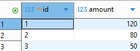
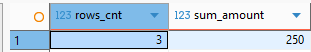
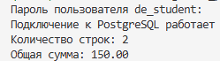
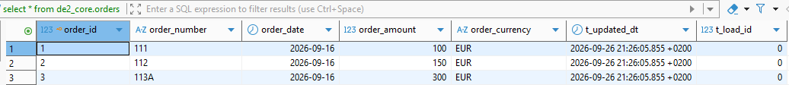
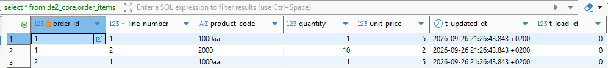
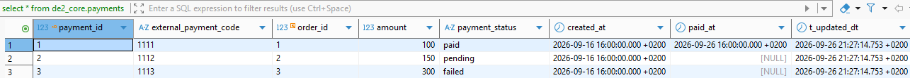
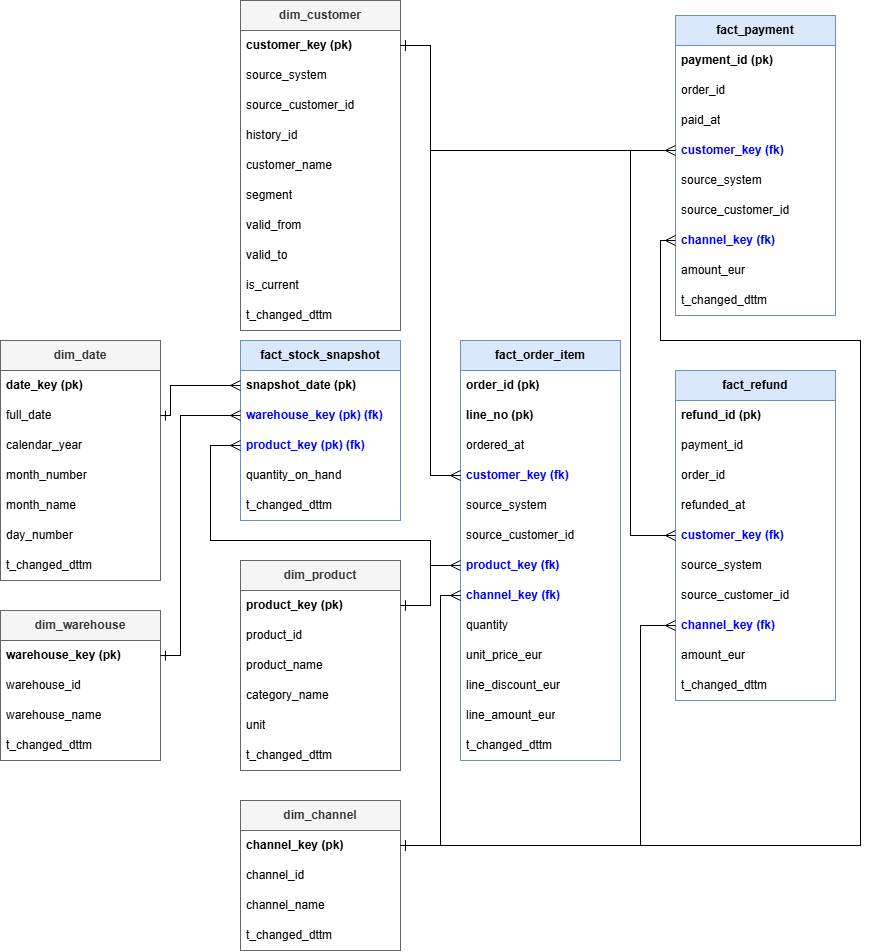

# de_project
## Назначение проекта: 
Цель работы - получить необходимые навыки для DE и собрать полноценный путь данных от источников данных до итогового проекта.


## Используемые версии инструментов:

* Python - 3.13.15
* PostgreSQL 18.6 on x86_64-windows, compiled by msvc-19.44.35228, 64-bit

## Настройка учебной базы
### Имя учебной базы 
de_course

### Команда установки зависимостей
```
python -m pip install -r requirements.txt
```
### Порядок выполнения SQL-проверки
```
sql/setup_check.sql
sql/homework_payments.sql
```

### Команда запуска Python-проверки
```
python src/check_connection.py
```
***
## Путь данных
**Постановка задачи**: Интернет-магазин хранит заказы в базе данных, получает платежи через API, а возвраты выгружает в CSV. Руководителю нужен ежедневный отчёт о заказах, платежах и возвратах за предыдущий день.

1. Источники - API платежей, CSV с возвратами, данные по заказам из БД
2. Загрузка данных из источников - настройка регулярной загрузки данных в хранилище
3. Staging - промежуточный слой для предварительной подготовки данных к последующей обработке - очистка, дедубликация, приведение данных к единому виду
4. DWH - объединение и хранение согласованных данных по заказам, платежам и возвратам, выстроенные в аналитическую модель
5. Трансформации - преобразования данных, например объединение заказов и оплат по ключу, расчеты сумм и количества и прочие расчеты
6. Витрина - набор связанных таблиц с данными по конкретной предметной области для дальнейшего использования в построении отчетов
7. Отчет - сводные данные для дальнейшего анализа

Для текущей задачи предварительно выбираем **ELT** подход, т.к. можно выгрузить данные источников из БД, csv, API в базу и хранить в исходном виде, а уже после выполнять их очистку, объединение и преобразование непосредстенно в хранилище. Этот подход позволит сохранить исходную детализацию для будущих иных аналитических задач.

| Роль               | Задача        |
| ------------------ |:-------------:|
| Data Engineer      | Настройка регулярной загрузки в хранилище данных платежей через API, возвратов из CSV, заказов из БД |
| Analytics Engineer | Построение модели данных хранилища и подготовка витрины интернет-магазина|
| Data Analyst       | Формирование требований к показателям и построение ежедневного отчета на основе витрины |

**Вопросы для уточнения инженером:**
* У разработчика API платежей: Время готовности источников к загрузке, частота обновления, инкремент или фулл, атрибутный состав и типы данных, pk
* У бизнеса: что именно считать заказом, платежом и возвратом, трактовка статусов, содержание и зерно отчета, период отчетного дня, время, к которому нужна итоговая отчетность


### Процесс подготовки поставки:
1. Изменения разрабатываются на DEV-контуре. 
2. Далее проводится тестирование определенной версии решения на TEST-контуре. 
3. После того, как поставка проходит тестирование, она переносится на PROD

Разделение сред позволяет исключить возможное негативное влияние на регламентные процессы на PROD и безболезненно откатить версию до стабильной в случаях, когда это необходимо. Для учебной работы достаточно доступа к DEV/TEST, т.к. среды (в идеале) содержат один и тот же набор инструментов, а так же достаточный для тестирования подготовленный набор данных, а основная цель обучения - разработка и проверка решения.

## Результаты проверки
```
select * 
from training.homework_payments
order by id
```


```
select 
	  count(*) as rows_cnt
	, sum(amount) as sum_amount
from training.homework_payments
```


```
python src/check_connection.py
```


***
# Неделя 2 - SQL для Data Engineering
## Задание 1 - Подключение нового магазина
| Схема      | Назначение    |
| -----------|:-------------:|
| de2_raw    | Исходные данные источников |
| de2_core   | Слой промежуточных данных |
| de2_mart   | Слой витрин |

### Создание схем и объектов
```
sql/week_02/task_01_ddl.sql
```
### Проверка вставки данных
```
sql/week_02/task_01_check.sql
```
#### Успешная вставка:




#### Ошибки:
1. Повтор order_number
```sql
insert into de2_core.orders (order_number, order_date, order_amount, order_currency, t_updated_dt, t_load_id) values
	('111', '2026-09-16', 100, 'EUR', current_timestamp, 0)
```
При повторе order_number происходит нарушение ограничения на уникальность атрибута order_number:
> SQL Error [23505]: ОШИБКА: повторяющееся значение ключа нарушает ограничение уникальности "orders_order_number_key"<br />
>  Detail: Ключ "(order_number)=(111)" уже существует.<br />
> Error position:
***
2. Платеж без существующего заказа
```sql
insert into de2_core.payments (external_payment_code, order_id, amount, payment_status, created_at, paid_at, t_updated_dt, t_load_id) values 
	('123', 999, 1, 'pending', '2026-09-16 14:00:00+00', null, current_timestamp, 0)
```
При записи платежа без существующего заказа происходит нарушение внешней связи с таблицей orders:
>SQL Error [23503]: ОШИБКА: INSERT или UPDATE в таблице "payments" нарушает ограничение внешнего ключа "fk_payments_x_order" <br />
>  Detail: Ключ (order_id)=(999) отсутствует в таблице "orders".

***
3. quantity = 0
```sql
insert into de2_core.order_items (order_id, line_number, product_code, quantity, unit_price, t_updated_dt, t_load_id) values
	(1, 1, '3000', 0, 5, current_timestamp, 0)
```
При записи деталей заказа с нулевым количеством товара происходит нарушения правила проверки корректности заполнения атрибута, по которому допустимы только значения больше 0:
>SQL Error [23514]: ОШИБКА: новая строка в отношении "order_items" нарушает ограничение-проверку "c_order_item_valid_quantity"<br />
>  Detail: Ошибочная строка содержит (1, 1, 3000, 0, 5.00, 2026-09-26 21:41:54.377281+02, 0).<br />
***
4. статус paid без paid_at
```sql
insert into de2_core.payments (external_payment_code, order_id, amount, payment_status, created_at, paid_at, t_updated_dt, t_load_id) values 
	('123', 1, 1, 'paid', '2026-09-16 14:00:00+00', null, current_timestamp, 0)
```
Происходит нарушение правила проверки, по которому дата paid_at должна заполняться только только для статуса paid и не должна только для статусов failed и pending:
>SQL Error [23514]: ОШИБКА: новая строка в отношении "payments" нарушает ограничение-проверку "c_payments_valid_paid_at"<br />
>  Detail: Ошибочная строка содержит (5, 123, 1, 1.00, paid, 2026-09-16 16:00:00+02, null, 2026-09-26 21:43:07.23593+02, 0).<br />


### Q&A
| Вопрос     | Ответ    |
| -----------|:-------------:|
| Почему суррогатный ключ не заменяет уникальность бизнес-кода? | Они имеют разные смыслы: бизнес-код определяет уникальность события с точки зрения бизнес-логики, тогда как суррогатный ключ определяет уникальную запись в базе и имеет технический характер. |
| Почему order_id не должен быть уникальным в таблице payments? | Одному заказу может соответствовать несколько событий оплаты - в случае нескольких успешных и неуспешных попыток, в случае разбивки оплаты на несколько платежей и т.д. |

## Задание 2 - Контроль входной поставки
```
sql/week_02/task_02.sql
```
#### Количество результатов по каждому rule_code, общее количество результатов и количество различных delivery_id
|rule_code|cnt_rule|cnt_total|cnt_uq_delivery_id|
|---------|--------|---------|------------------|
|duplicate_key|8|22|21|
|future_date|1|22|21|
|invalid_amount|4|22|21|
|invalid_status|1|22|21|
|paid_before_created|1|22|21|
|required_fields|4|22|21|
|status_date_mismatch|2|22|21|
|unknown_order|1|22|21|

#### Подробный реестр
|delivery_id|source_system|payment_id|rule_code|
|-----------|-------------|----------|---------|
|1|gate_a|4001|duplicate_key|
|2|gate_a|4001|duplicate_key|
|3|gate_a|4002|duplicate_key|
|4|gate_a|4002|duplicate_key|
|6|gate_a|4004|unknown_order|
|7|gate_a||invalid_amount|
|7|gate_a||required_fields|
|8|gate_a|4005|invalid_amount|
|9|gate_a|4006|invalid_status|
|10|gate_a|4007|status_date_mismatch|
|11|gate_a|4008|paid_before_created|
|12|gate_a|4009|required_fields|
|13|gate_a|4010|required_fields|
|14|gate_a|4011|future_date|
|16|gate_a|4013|duplicate_key|
|17|gate_a|4013|duplicate_key|
|19|gate_a|4014|required_fields|
|20|gate_a|4015|status_date_mismatch|
|21|gate_a|4016|invalid_amount|
|22|gate_a|4017|invalid_amount|
|23|gate_a|4018|duplicate_key|
|24|gate_a|4018|duplicate_key|

### Q&A
| Вопрос     | Ответ    |
| -----------|:-------------:|
| Почему число результатов проверок может быть больше числа проверенных записей с замечаниями? | Одна и та же запись может провалить сразу несколько непротиворечащих друг другу проверок КД |
| Какие повторы требуют выбора версии? | Выбора версии требуют записи, которые не прошли проверку на дубликаты по бизнес-ключу, т.к. это могут быть задублированные данные или долеты обновлений|
| Какие правила выявляют недопустимое содержимое?| invalid_amount, invalid_status, future_date, paid_before_created, status_date_mismatch, а также unknown_order - отсутствие связности между данными, когда в дочернюю таблицу попали идентификаторы, которых нет в родительской |

## Задание 3 - Куда исчезли платежи
```
sql/week_02/task_03.sql
```
#### Таблица контроля по этапам
|stage|row_count|total_amount|
|-----|---------|------------|
|payments|18|1740.00|
|payments+orders|17|1685.00|
|payments+orders+customers|16|1575.00|

#### Полная обогащенная выгрузка
|payment_id|order_id|amount|payment_status|customer_id|customer_name|
|----------|--------|------|--------------|-----------|-------------|
|3001|2001|120.00|paid|101|Альфа|
|3002|2001|80.00|paid|101|Альфа|
|3003|2002|120.00|pending|101|Альфа|
|3004|2003|90.00|paid|102|Вектор|
|3005|2004|100.00|paid|102|Вектор|
|3006|2004|100.00|paid|102|Вектор|
|3007|2005|70.00|failed|103|Орион|
|3008|2006|200.00|paid|103|Орион|
|3009|2006|100.00|paid|103|Орион|
|3010|2007|30.00|paid|104|Линия|
|3011|2008|40.00|paid|105|Сфера|
|3012|2009|180.00|pending|106|Маяк|
|3013|2010|110.00|paid|999||
|3014|2011|125.00|paid|104|Линия|
|3015|2999|55.00|paid|||
|3016|2002|120.00|paid|101|Альфа|
|3017|2001|15.00|failed|101|Альфа|
|3018|2012|85.00|paid|106|Маяк|

#### Контроль собранных данных
|row_count|payment_count|total_amount|
|---------|-------------|------------|
|18|18|1740.00|


#### Несопоставленные операции
|payment_id|missing_object|missing_id|
|----------|--------------|----------|
|3013|customer_id|999|
|3015|order_id|2999|

### Q&A
>Какие ограничения или проверки нужны на стороне справочников, чтобы LEFT JOIN сохранял по одной строке на платёж? Почему непустой customer_id ещё не доказывает, что клиент существует?

По одной строке на платеж по результатам left join будет сохраняться в том случае, если оплата относится к одному заказу, заказ относится к одному клиенту, в иных случаях записи будут множиться.<br /> 
Может быть ситуация, когда customer_id заполнен в orders, но клиент отсутствует в customers (к примеру, в источнике данные клиента были по какой-то причине удалены/не были загружены в базу) - это нарушение связности по внешнему ключу.


## Задание 4 - Отчёт завысил поступления
```
sql/week_02/task_04.sql
```
#### Размноженные данные
|order_id|rows_cnt|total_cst|paid_amount_direct|
|--------|--------|---------|------------------|
|2001|4|400.00|400.00|
|2002|1|120.00|120.00|
|2003|1|90.00|90.00|
|2004|4|300.00|400.00|
|2005|1|70.00||
|2006|4|600.00|600.00|
|2007|1|30.00|30.00|
|2008|1|40.00|40.00|
|2009|2|180.00||
|2010|1|110.00|110.00|
|2011|2|125.00|250.00|
|2012|1|85.00|85.00|

#### Агрегат с корректными суммами, одна строка = один заказ
|order_id|order_amount|item_count|items_amount|paid_count|paid_amount|balance_amount|
|--------|------------|----------|------------|----------|-----------|--------------|
|2001|200.00|2|200.00|2|200.00|0.00|
|2002|120.00|1|120.00|1|120.00|0.00|
|2003|90.00|1|90.00|1|90.00|0.00|
|2004|150.00|2|150.00|2|200.00|-50.00|
|2005|70.00|1|70.00|0|0|70.00|
|2006|300.00|2|300.00|2|300.00|0.00|
|2007|30.00|1|30.00|1|30.00|0.00|
|2008|40.00|1|40.00|1|40.00|0.00|
|2009|180.00|2|180.00|0|0|180.00|
|2010|110.00|1|110.00|1|110.00|0.00|
|2011|125.00|2|125.00|1|125.00|0.00|
|2012|85.00|1|85.00|1|85.00|0.00|

#### Проверка корректности витрины:
|orders_count|orders_total|items_count|items_total|paid_count|paid_total|
|------------|------------|-----------|-----------|----------|----------|
|12|1500.00|17|1500.00|13|1300.00|


#### Пример заказа с размноженными данными
|order_id|order_amount|product_code|quantity|unit_price|payment_id|paid_amount|
|--------|------------|------------|--------|----------|----------|-----------|
|2006|300.00|CHAIR|2|100.00|3008|200.00|
|2006|300.00|DESK|1|100.00|3008|200.00|
|2006|300.00|CHAIR|2|100.00|3009|100.00|
|2006|300.00|DESK|1|100.00|3009|100.00|

На один заказ order_id = 2006 в order_items приходится две позиции с общей суммой 300 EUR:
|order_id|items_amount|item_count|
|--------|------------|----------|
|2006|300.00|2|

В то же время на один заказ приходится две записи с успешной оплатой в payments:
|order_id|paid_amount|paid_count|
|--------|-----------|----------|
|2006|300.00|2|

Из-за того, что в таблицах разная гранулярность (для orders строка = один заказ, для order_items строка = одна из многих позиций в заказе, для payments строка = один факт оплаты из многих по заказу), прямое соединение без предварительной агрегации размножает записи, т.к. соединение происходит не по уникальным атрибутам. DISTINCT в таком случае не решает проблему, т.к.:
1. дубли по order_id в order_items и payments - это не дублирование данных по товарам и платежам, у этих данных другой смысл
2. при прямом соединении по дублирующимся значениям происходит cross join - получается декартово произведение, когда каждая строка соединяется с каждой строкой с таким же идентификатором, получается количество комбинаций 1 (запись в orders) * 2 (order_items) * 2 (payments) = 4 строки

Для корректного результата необходимо предварительно сгруппировать данные по позициям и платежам до той же гранулярности, что и в заказе, т.е. до одного заказа - по order_id, тогда соединение даст правильный результат и записи не будут замножены.

## Задание 5 - Поздняя доставка старой записи
```
sql/week_02/task_05.sql
```
#### Актуальная версия-1
|delivery_id|source_system|payment_id|order_id|amount|payment_status|created_on|paid_on|source_updated_at|loaded_at|
|-----------|-------------|----------|--------|------|--------------|----------|-------|-----------------|---------|
|2|gate_a|4001|2001|120.00|paid|2026-09-14|2026-09-14|2026-09-14 11:00:00.000 +0200|2026-09-17 10:01:00.000 +0200|
|4|gate_a|4002|2002|120.00|paid|2026-09-14|2026-09-15|2026-09-15 11:00:00.000 +0200|2026-09-17 10:03:00.000 +0200|
|5|gate_a|4003|2003|90.00|paid|2026-09-14|2026-09-14|2026-09-14 13:00:00.000 +0200|2026-09-17 10:04:00.000 +0200|
|6|gate_a|4004|2999|55.00|paid|2026-09-16|2026-09-16|2026-09-16 12:00:00.000 +0200|2026-09-17 10:05:00.000 +0200|
|8|gate_a|4005|2005|-70.00|paid|2026-09-15|2026-09-15|2026-09-15 12:00:00.000 +0200|2026-09-17 10:07:00.000 +0200|
|9|gate_a|4006|2006|200.00|unknown|2026-09-15||2026-09-15 14:00:00.000 +0200|2026-09-17 10:08:00.000 +0200|
|10|gate_a|4007|2007|30.00|paid|2026-09-16||2026-09-16 10:00:00.000 +0200|2026-09-17 10:09:00.000 +0200|
|11|gate_a|4008|2008|40.00|paid|2026-09-16|2026-09-15|2026-09-16 11:00:00.000 +0200|2026-09-17 10:10:00.000 +0200|
|12|gate_a|4009|2009||pending|2026-09-16||2026-09-16 11:00:00.000 +0200|2026-09-17 10:11:00.000 +0200|
|13|gate_a|4010|2010|110.00|paid||2026-09-16|2026-09-16 12:00:00.000 +0200|2026-09-17 10:12:00.000 +0200|
|14|gate_a|4011|2011|125.00|paid|2026-09-18|2026-09-18|2026-09-16 15:00:00.000 +0200|2026-09-17 10:13:00.000 +0200|
|15|gate_a|4012|2012|85.00|pending|2026-09-16||2026-09-16 16:00:00.000 +0200|2026-09-17 10:14:00.000 +0200|
|17|gate_a|4013|2004|155.00|paid|2026-09-15|2026-09-15|2026-09-15 18:00:00.000 +0200|2026-09-17 10:15:00.000 +0200|
|19|gate_a|4014||60.00|paid|2026-09-16|2026-09-16|2026-09-16 14:00:00.000 +0200|2026-09-17 10:17:00.000 +0200|
|20|gate_a|4015|2008|40.00|pending|2026-09-16|2026-09-16|2026-09-16 16:00:00.000 +0200|2026-09-17 10:18:00.000 +0200|
|21|gate_a|4016|2005|0.00|failed|2026-09-15||2026-09-15 12:00:00.000 +0200|2026-09-17 10:19:00.000 +0200|
|22|gate_a|4017|2009|20000.00|paid|2026-09-16|2026-09-16|2026-09-16 17:00:00.000 +0200|2026-09-17 10:20:00.000 +0200|
|23|gate_a|4018|2007|30.00|paid|2026-09-16|2026-09-16|2026-09-16 18:00:00.000 +0200|2026-09-17 10:21:00.000 +0200|
|18|gate_b|4001|2006|100.00|paid|2026-09-16|2026-09-16|2026-09-16 13:00:00.000 +0200|2026-09-17 10:16:00.000 +0200|

#### Актуальная версия-2
|delivery_id|source_system|payment_id|order_id|amount|payment_status|created_on|paid_on|source_updated_at|loaded_at|
|-----------|-------------|----------|--------|------|--------------|----------|-------|-----------------|---------|
|2|gate_a|4001|2001|120.00|paid|2026-09-14|2026-09-14|2026-09-14 11:00:00.000 +0200|2026-09-17 10:01:00.000 +0200|
|4|gate_a|4002|2002|120.00|paid|2026-09-14|2026-09-15|2026-09-15 11:00:00.000 +0200|2026-09-17 10:03:00.000 +0200|
|5|gate_a|4003|2003|90.00|paid|2026-09-14|2026-09-14|2026-09-14 13:00:00.000 +0200|2026-09-17 10:04:00.000 +0200|
|6|gate_a|4004|2999|55.00|paid|2026-09-16|2026-09-16|2026-09-16 12:00:00.000 +0200|2026-09-17 10:05:00.000 +0200|
|8|gate_a|4005|2005|-70.00|paid|2026-09-15|2026-09-15|2026-09-15 12:00:00.000 +0200|2026-09-17 10:07:00.000 +0200|
|9|gate_a|4006|2006|200.00|unknown|2026-09-15||2026-09-15 14:00:00.000 +0200|2026-09-17 10:08:00.000 +0200|
|10|gate_a|4007|2007|30.00|paid|2026-09-16||2026-09-16 10:00:00.000 +0200|2026-09-17 10:09:00.000 +0200|
|11|gate_a|4008|2008|40.00|paid|2026-09-16|2026-09-15|2026-09-16 11:00:00.000 +0200|2026-09-17 10:10:00.000 +0200|
|12|gate_a|4009|2009||pending|2026-09-16||2026-09-16 11:00:00.000 +0200|2026-09-17 10:11:00.000 +0200|
|13|gate_a|4010|2010|110.00|paid||2026-09-16|2026-09-16 12:00:00.000 +0200|2026-09-17 10:12:00.000 +0200|
|14|gate_a|4011|2011|125.00|paid|2026-09-18|2026-09-18|2026-09-16 15:00:00.000 +0200|2026-09-17 10:13:00.000 +0200|
|15|gate_a|4012|2012|85.00|pending|2026-09-16||2026-09-16 16:00:00.000 +0200|2026-09-17 10:14:00.000 +0200|
|17|gate_a|4013|2004|155.00|paid|2026-09-15|2026-09-15|2026-09-15 18:00:00.000 +0200|2026-09-17 10:15:00.000 +0200|
|19|gate_a|4014||60.00|paid|2026-09-16|2026-09-16|2026-09-16 14:00:00.000 +0200|2026-09-17 10:17:00.000 +0200|
|20|gate_a|4015|2008|40.00|pending|2026-09-16|2026-09-16|2026-09-16 16:00:00.000 +0200|2026-09-17 10:18:00.000 +0200|
|21|gate_a|4016|2005|0.00|failed|2026-09-15||2026-09-15 12:00:00.000 +0200|2026-09-17 10:19:00.000 +0200|
|22|gate_a|4017|2009|20000.00|paid|2026-09-16|2026-09-16|2026-09-16 17:00:00.000 +0200|2026-09-17 10:20:00.000 +0200|
|24|gate_a|4018|2007|35.00|paid|2026-09-16|2026-09-16|2026-09-16 17:00:00.000 +0200|2026-09-17 10:22:00.000 +0200|
|18|gate_b|4001|2006|100.00|paid|2026-09-16|2026-09-16|2026-09-16 13:00:00.000 +0200|2026-09-17 10:16:00.000 +0200|

#### Список неполных ключей
|delivery_id|source_system|payment_id|order_id|amount|payment_status|created_on|paid_on|source_updated_at|loaded_at|
|-----------|-------------|----------|--------|------|--------------|----------|-------|-----------------|---------|
|7|gate_a||2004|-50.00|paid|2026-09-15|2026-09-15|2026-09-15 10:00:00.000 +0200|2026-09-17 10:06:00.000 +0200|

#### Не попали в актуальные версии в варианте 1
|delivery_id|source_system|payment_id|order_id|amount|payment_status|created_on|paid_on|source_updated_at|loaded_at|rn|
|-----------|-------------|----------|--------|------|--------------|----------|-------|-----------------|---------|--|
|1|gate_a|4001|2001|120.00|paid|2026-09-14|2026-09-14|2026-09-14 11:00:00.000 +0200|2026-09-17 10:00:00.000 +0200|2|
|3|gate_a|4002|2002|100.00|pending|2026-09-14||2026-09-14 14:00:00.000 +0200|2026-09-17 10:02:00.000 +0200|2|
|16|gate_a|4013|2004|150.00|paid|2026-09-15|2026-09-15|2026-09-15 18:00:00.000 +0200|2026-09-17 10:15:00.000 +0200|2|
|24|gate_a|4018|2007|35.00|paid|2026-09-16|2026-09-16|2026-09-16 17:00:00.000 +0200|2026-09-17 10:22:00.000 +0200|2|

#### Не попали в актуальные версии в варианте 2
|delivery_id|source_system|payment_id|order_id|amount|payment_status|created_on|paid_on|source_updated_at|loaded_at|rn|
|-----------|-------------|----------|--------|------|--------------|----------|-------|-----------------|---------|--|
|1|gate_a|4001|2001|120.00|paid|2026-09-14|2026-09-14|2026-09-14 11:00:00.000 +0200|2026-09-17 10:00:00.000 +0200|2|
|3|gate_a|4002|2002|100.00|pending|2026-09-14||2026-09-14 14:00:00.000 +0200|2026-09-17 10:02:00.000 +0200|2|
|16|gate_a|4013|2004|150.00|paid|2026-09-15|2026-09-15|2026-09-15 18:00:00.000 +0200|2026-09-17 10:15:00.000 +0200|2|
|23|gate_a|4018|2007|30.00|paid|2026-09-16|2026-09-16|2026-09-16 18:00:00.000 +0200|2026-09-17 10:21:00.000 +0200|2|

#### Сравнение двух способов сортировки и исходных данных
|stage|total_rows_count|pk_doubles_count|
|-----|----------------|----------------|
|original|24|4|
|var1|19|0|
|var2|19|0|

>Почему время получения не определяет актуальность версии? Зачем source_system входит в ключ? Какие поля определяют выбор при полностью совпавших временных метках?

Могут возникать долеты старых данных, к примеру, когда один из источников не был доступен и данные были выгружены с опозданием. source_system входит в ключ для того, чтобы была возможность однозначно определить запись, т.к. идентификаторы оплаты могут пересекаться между источниками. При полностью совпавших временных метках выбор доопределяется по идентификатору доставки.


## Задание 6 - Подготовка дневных поступлений
```
sql/week_02/task_06.sql
```
1. Получите дневной результат paid_on, payment_count, paid_amount, отсортированный по дате. Показывайте только дни с подходящими платежами.

|paid_on|payment_count|payment_amount|
|-------|-------------|--------------|
|2026-09-14|2|210.00|
|2026-09-15|2|275.00|
|2026-09-16|2|130.00|

2. С теми же CTE выведите контроль для source_rows, keyed, latest, valid, paid, matched: stage, row_count, amount_count, total_amount. amount_count означает COUNT(amount). SUM не заменяйте нулём автоматически.

|stage|row_count|amount_count|total_amount|
|-----|---------|------------|------------|
|1 source_rows|24|23|21645.00|
|2 keyed|23|22|21695.00|
|3 latest|19|18|21290.00|
|4 valid|8|8|755.00|
|5 paid|7|7|670.00|
|6 matched|6|6|615.00|

3. Подготовьте журнал исключений delivery_id, excluded_at. Для каждого перехода верните строки, бывшие на входе, но отсутствующие на выходе. Каждая исключённая доставка должна быть указана один раз - на первом исключившем её этапе.

|delivery_id|excluded_at|
|-----------|-----------|
|1|3 latest|
|3|3 latest|
|6|6 matched|
|7|2 keyed|
|8|4 valid|
|9|4 valid|
|10|4 valid|
|11|4 valid|
|12|4 valid|
|13|4 valid|
|14|4 valid|
|15|5 paid|
|16|3 latest|
|19|4 valid|
|20|4 valid|
|21|4 valid|
|22|4 valid|
|24|3 latest|

4. Сверьте SUM(payment_count) дневного результата с числом строк matched, а SUM(paid_amount) - с суммой matched.amount.

|daily_rows_cnt|matched_rows_cnt|diff_rows_cnt|daily_payment_amt|matched_payment_amt|diff_payment_amt|
|--------------|----------------|-------------|-----------------|-------------------|----------------|
|6|6|0|615.00|615.00|0.00|

> Почему после выбора версий сумма может уменьшиться или увеличиться? Как отличить ожидаемое изменение количества строк от потери данных при соединении?

В зависимости от выбранного способа сортировки в итоговый результат могут попасть записи с разными суммами, т.к. в нашем примере оба варианта сортировки никак не зависят от amount. Также при переходе от всех доставок к актуальным версиям сумма меняется из-за удаления невыбранных строк. В данном наборе исключаются суммы 120, 100, 150 и 35 EUR, всего 405 EUR. Если бы исключались отрицательные значения, общая сумма могла бы увеличиться. <br /> 
Для того, чтобы отличить ожидаемое изменение количества строк от потери данных при джойне стоит помимо результата джойна проверить те записи, которые не сопоставились при соединении - это даст точное понимание, какая часть данных не попала, и возможность отловить некоторые явные паттерны, из-за которых данные могли отвалиться.

## Задание 7 - История оплат и рейтинг заказов
```
sql/week_02/task_07.sql
```
Подробная история с оконными показателями

|order_id|payment_id|paid_at|amount|previous_amount|next_amount|amount_change|running_amount|
|--------|----------|-------|------|---------------|-----------|-------------|--------------|
|2001|3001|2026-09-14 11:00:00.000 +0200|120.00||80.00||120.00|
|2001|3002|2026-09-14 12:00:00.000 +0200|80.00|120.00||-40.00|200.00|
|2003|3004|2026-09-14 13:00:00.000 +0200|90.00||||90.00|
|2004|3005|2026-09-15 10:00:00.000 +0200|100.00||100.00||100.00|
|2004|3006|2026-09-15 10:00:00.000 +0200|100.00|100.00||0.00|200.00|
|2006|3008|2026-09-15 14:00:00.000 +0200|200.00||100.00||200.00|
|2006|3009|2026-09-16 11:00:00.000 +0200|100.00|200.00||-100.00|300.00|
|2007|3010|2026-09-16 12:00:00.000 +0200|30.00||||30.00|
|2008|3011|2026-09-16 13:00:00.000 +0200|40.00||||40.00|
|2010|3013|2026-09-16 14:00:00.000 +0200|110.00||||110.00|
|2011|3014|2026-09-16 15:00:00.000 +0200|125.00||||125.00|

Полный рейтинг заказов
|order_id|paid_amount|amount_rank|amount_dense_rank|
|--------|-----------|-----------|-----------------|
|2006|300.00|1|1|
|2001|200.00|2|2|
|2004|200.00|2|2|
|2011|125.00|4|3|
|2010|110.00|5|4|
|2003|90.00|6|5|
|2008|40.00|7|6|
|2007|30.00|8|7|

Две наибольшие различные суммы заказов
|order_id|paid_amount|amount_rank|amount_dense_rank|
|--------|-----------|-----------|-----------------|
|2006|300.00|1|1|
|2001|200.00|2|2|
|2004|200.00|2|2|

>Почему для накопительной суммы нужен дополнительный ключ payment_id, а для равенства мест рейтинга он не должен входить в ORDER BY внутри OVER? <br /> 

Для накопительной суммы важно учитывать порядок платежей, и payment_id доопределяет сортировку. Для равенства мест рейтинга он не нужен, т.к. рассматривается уже сумма платежей.

>Почему в последнем результате может быть больше двух строк?<br /> 

Важным условием является вывести заказы с двумя наибольшими суммами, а не два наибольших заказа; несколько разных заказов могут быть на одну и ту же сумму платежей.

## Задание 8 - Суммы совпали. Можно публиковать?
```
sql/week_02/task_08.sql
```
1. Проверка уникальности ключей:

|source|count|count|sum|
|------|-----|-----|---|
|ledger_before|6|6|700.00|
|ledger_after|6|6|700.00|

2. Сверка

|lb_payment_id|la_payment_id|before_amount|after_amount|before_currency|after_currency|before_paid_on|after_paid_on|missing_after|new_after|amount_changed|currency_changed|date_changed|
|-------------|-------------|-------------|------------|---------------|--------------|--------------|-------------|-------------|---------|--------------|----------------|------------|
|5001|5001|100.00|100.00|EUR|EUR|2026-09-14|2026-09-14|false|false|false|false|false|
|5002|5002|150.00|160.00|EUR|EUR|2026-09-14|2026-09-14|false|false|true|false|false|
|5003|5003|200.00|200.00|EUR|EUR|2026-09-15|2026-09-16|false|false|false|false|true|
|5004|5004|80.00|80.00|EUR|EUR|2026-09-15|2026-09-15|false|false|false|false|false|
|5005||120.00||EUR||2026-09-16||true|false|false|false|false|
|5006|5006|50.00|50.00|EUR|EUR|2026-09-16|2026-09-16|false|false|false|false|false|
||5007||110.00||EUR||2026-09-16|false|true|false|false|false|

3. Расхождения

|payment_id|before_amount|after_amount|before_currency|after_currency|before_paid_on|after_paid_on|missing_after|new_after|amount_changed|currency_changed|date_changed|
|----------|-------------|------------|---------------|--------------|--------------|-------------|-------------|---------|--------------|----------------|------------|
|5002|150.00|160.00|EUR|EUR|2026-09-14|2026-09-14|false|false|true|false|false|
|5003|200.00|200.00|EUR|EUR|2026-09-15|2026-09-16|false|false|false|false|true|
|5005|120.00||EUR||2026-09-16||true|false|false|false|false|
|5007||110.00||EUR||2026-09-16|false|true|false|false|false|

4. Решение о публикации - не допущено, требует исправления ошибок

Нарушены следующие требования: поменялись ключи (пропала одна старая запись и появилась одна новая), есть расхождения в суммах и датах платежей.<br /> 
Необходимо проверить следующие ключи:<br /> 
payment_id = 5002 - изменилась сумма платежа 150.00	-> 160.00<br /> 
payment_id = 5003 - изменилась дата платежа 2026-09-15 -> 2026-09-16<br /> 
payment_id = 5005 - запись пропала<br /> 
payment_id = 5007 - новая запись, есть вероятность, что это "поехавшая" запись для 5005, но не совпадают суммы платежей - требуется проверить, откуда появилась запись<br /> 
Ожидаемый результат после исправления: восстановление записи payment_id = 5005 со значениями 120 EUR и датой 2026-09-16, отсутствие лишней записи payment_id = 5007, сумма 150 EUR для payment_id = 5002 и дата 2026-09-15 для payment_id = 5003. Сверка после исправления ошибок не выдает расхождений с исходным регистром.<br /> 

> Почему одинаковые количество строк и сумма не доказывают корректность переноса? Какие две разные ошибки могут компенсировать друг друга в общей сумме?<br /> 
К примеру, может оказаться, что для одной строки увеличена сумма платежа, в другой - уменьшена на то же значение, либо съехали ключи, но значения остальных атрибутов остались, и итоговый результат в итоге компенсируется. Для того, чтобы однозначно определить корректность переноса, лучше проводить поатрибутную сверку, чтобы точно определить, есть ли расхождения по ключам и по значениям атрибутов.

***
# Неделя 3 - Моделирование данных
## Задание 1 - Проектирование аналитической модели

| Наименование объекта | Описание таблицы| Детализация | Ключ строки | Измерения | Показатели | Тип факта |
| ---------------------|-----------------|-------------|--------------------|-----------|------------|-----------|
| fact_order_item | Позиции завершённых заказов | Одна позиция в завершенном заказе | order_id, line_no |dim_customer, dim_product, dim_channel|Количество товаров в позициях (quantity), стоимость товара (unit_price_eur, line_discount_eur, line_amount_eur)| Транзакционный |
| fact_payment | Успешные платежи | Одна успешная платежная операция | payment_id |dim_customer, dim_channel|Сумма операции (amount_eur)| Транзакционный |
| fact_refund | Успешные возвраты | Одна успешная операция возврата одного платежа | refund_id |dim_customer, dim_channel|Сумма операции (amount_eur)| Транзакционный |
| fact_stock_snapshot | Ежедневные остатки | Остаток товара на конкретном складе на конец дня | snapshot_date, warehouse_key, product_key |dim_date, dim_warehouse, dim_product|Остаток на конец дня (quantity_on_hand)| Периодический снимок |



Номер заказа не является уникальным ключом платежа или позиции, т.к. заказ может содержать более одной позиции, по заказу может проходить более одной платежной операции.<br /> 
Общее измерение dim_date используется при построении витрин в ролях даты заказа, платежа и возврата. Календарная дата определяется по ordered_at, paid_at или refunded_at в часовом поясе Europe/Berlin. В фактах сохраняется точное время события. <br /> 

> Для каждого показателя ниже укажите, что можно суммировать, по каким измерениям и при каких условиях <br /> 

|Показатель |Что можно суммировать, по каким измерениям и при каких условиях|
| ---------------------|-----------------|
|Сумма платежей и возвратов|Сумма amount_eur в разрезе заказа/клиента/канала за необходимые даты, если требуется оборот - требуется учитывать также направление платежа (платеж/возврат), учитываются успешные операции|
|Количество товаров в позициях|Сумма quantity (в штуках) в разрезе заказа/клиента, необходимо рассматривать завершенные не тестовые заказы|
|Остаток на конец дня| Сумма quantity (в штуках) по товарам и складам на одну дату при условии полного покрытия и общих единицах измерения|
|Средняя сумма платежа|Cумма успешных платежей, деленная на их количество|

> Объясните, почему платежи нельзя напрямую распределить по товарам заказа на основании только имеющихся данных. Укажите, какого правила или источника не хватает.<br /> 

По одному заказу может проходить больше одного платежа, при этом нет указания, какая конкретно позиция из заказа покрывается конкретным платежом 

## Задание 2 - Создание измерений и истории клиентов
```
sql/week_03/task_02.sql
```
#### de3_dwh.dim_customer
|customer_key|source_system|source_customer_id|history_id|customer_name|segment|valid_from|valid_to|is_current|t_changed_dttm|
|------------|-------------|------------------|----------|-------------|-------|----------|--------|----------|--------------|
|0||||Неизвестный клиент|unknown||||2026-10-09 22:38:33.389 +0200|
|1|crm|001|11|Анна Морозова|standard|2025-01-01 00:00:00.000 +0100|2025-09-03 00:00:00.000 +0200|false|2026-10-09 22:38:33.393 +0200|
|2|crm|001|12|Анна Морозова|premium|2025-09-03 00:00:00.000 +0200||true|2026-10-09 22:38:33.393 +0200|
|3|crm|002|21|Борис Ким|standard|2025-01-01 00:00:00.000 +0100||true|2026-10-09 22:38:33.393 +0200|
|4|pos|001|31|Карла Вебер|standard|2025-01-01 00:00:00.000 +0100||true|2026-10-09 22:38:33.393 +0200|
|5|crm|003|41|Дмитрий Орлов|standard|2025-01-01 00:00:00.000 +0100||true|2026-10-09 22:38:33.393 +0200|

#### de3_dwh.dim_product
|product_key|product_id|product_name|category_name|unit|t_changed_dttm|
|-----------|----------|------------|-------------|----|--------------|
|1|p001|Кофеварка|Техника|шт.|2026-10-03 21:32:27.552 +0200|
|2|p002|Чайник|Техника|шт.|2026-10-03 21:32:27.552 +0200|
|3|p003|Кружка|Посуда|шт.|2026-10-03 21:32:27.552 +0200|
|4|p004|Банка для кофе|Хранение|шт.|2026-10-03 21:32:27.552 +0200|

#### de3_dwh.dim_channel
|channel_key|channel_id|channel_name|t_changed_dttm|
|-----------|----------|------------|--------------|
|1|web|Интернет-магазин|2026-10-03 21:32:27.563 +0200|
|2|shop|Розничный магазин|2026-10-03 21:32:27.563 +0200|
|3|partner|Партнёры|2026-10-03 21:32:27.563 +0200|

#### de3_dwh.dim_warehouse
|warehouse_key|warehouse_id|warehouse_name|t_changed_dttm|
|-------------|------------|--------------|--------------|
|1|w01|Берлин|2026-10-03 21:32:27.575 +0200|
|2|w02|Гамбург|2026-10-03 21:32:27.575 +0200|

#### de3_dwh.dim_date
|date_key|full_date|calendar_year|month_number|month_name|day_number|t_changed_dttm|
|--------|---------|-------------|------------|----------|----------|--------------|
|20250831|2025-08-31 00:00:00.000 +0200|2025|8|Август|31|2026-10-03 21:32:27.589 +0200|
|20250901|2025-09-01 00:00:00.000 +0200|2025|9|Сентябрь|1|2026-10-03 21:32:27.589 +0200|
|20250902|2025-09-02 00:00:00.000 +0200|2025|9|Сентябрь|2|2026-10-03 21:32:27.589 +0200|
|20250903|2025-09-03 00:00:00.000 +0200|2025|9|Сентябрь|3|2026-10-03 21:32:27.589 +0200|
|20250904|2025-09-04 00:00:00.000 +0200|2025|9|Сентябрь|4|2026-10-03 21:32:27.589 +0200|
|20250905|2025-09-05 00:00:00.000 +0200|2025|9|Сентябрь|5|2026-10-03 21:32:27.589 +0200|
|20250906|2025-09-06 00:00:00.000 +0200|2025|9|Сентябрь|6|2026-10-03 21:32:27.589 +0200|
|20250907|2025-09-07 00:00:00.000 +0200|2025|9|Сентябрь|7|2026-10-03 21:32:27.589 +0200|

## Задание 3 - Загрузка транзакционных фактов
```
sql/week_03/task_03.sql
```
#### de3_dwh.fact_order_item
|order_id|line_no|ordered_at|customer_key|source_system|source_customer_id|product_key|channel_key|quantity|unit_price_eur|line_discount_eur|line_amount_eur|t_changed_dttm|
|--------|-------|----------|------------|-------------|------------------|-----------|-----------|--------|--------------|-----------------|---------------|--------------|
|o1001|1|2025-09-01 00:30:00.000 +0200|1|crm|001|1|1|1|100.00|10.00|90.00|2026-10-09 22:38:51.018 +0200|
|o1001|2|2025-09-01 00:30:00.000 +0200|1|crm|001|3|1|2|10.00|0.00|20.00|2026-10-09 22:38:51.018 +0200|
|o1002|1|2025-09-01 11:00:00.000 +0200|3|crm|002|2|2|1|60.00|0.00|60.00|2026-10-09 22:38:51.018 +0200|
|o1003|1|2025-09-02 22:00:00.000 +0200|1|crm|001|1|1|1|100.00|0.00|100.00|2026-10-09 22:38:51.018 +0200|
|o1003|2|2025-09-02 22:00:00.000 +0200|1|crm|001|3|1|1|10.00|0.00|10.00|2026-10-09 22:38:51.018 +0200|
|o1004|1|2025-09-03 12:00:00.000 +0200|4|pos|001|2|2|2|60.00|10.00|110.00|2026-10-09 22:38:51.018 +0200|
|o1006|1|2025-09-05 13:00:00.000 +0200|2|crm|001|3|1|3|10.00|0.00|30.00|2026-10-09 22:38:51.018 +0200|
|o1006|2|2025-09-05 13:00:00.000 +0200|2|crm|001|2|1|1|60.00|0.00|60.00|2026-10-09 22:38:51.018 +0200|
|o1007|1|2025-09-06 14:00:00.000 +0200|0|crm|999|2|1|1|60.00|5.00|55.00|2026-10-09 22:38:51.018 +0200|
|o1009|1|2025-08-31 20:00:00.000 +0200|5|crm|003|1|2|1|100.00|0.00|100.00|2026-10-09 22:38:51.018 +0200|
|o1010|1|2025-09-07 16:00:00.000 +0200|5|crm|003|2|1|2|60.00|0.00|120.00|2026-10-09 22:38:51.018 +0200|

#### de3_dwh.fact_payment
|payment_id|order_id|paid_at|customer_key|source_system|source_customer_id|channel_key|amount_eur|t_changed_dttm|
|----------|--------|-------|------------|-------------|------------------|-----------|----------|--------------|
|p02|o1001|2025-09-01 10:00:00.000 +0200|1|crm|001|1|50.00|2026-10-09 22:38:51.040 +0200|
|p01|o1001|2025-09-01 00:35:00.000 +0200|1|crm|001|1|60.00|2026-10-09 22:38:51.040 +0200|
|p03|o1002|2025-09-01 11:10:00.000 +0200|3|crm|002|2|60.00|2026-10-09 22:38:51.040 +0200|
|p06|o1003|2025-09-03 00:00:00.000 +0200|2|crm|001|1|70.00|2026-10-09 22:38:51.040 +0200|
|p05|o1003|2025-09-02 23:30:00.000 +0200|1|crm|001|1|40.00|2026-10-09 22:38:51.040 +0200|
|p07|o1004|2025-09-03 12:10:00.000 +0200|4|pos|001|2|110.00|2026-10-09 22:38:51.040 +0200|
|p10|o1006|2025-09-06 13:10:00.000 +0200|2|crm|001|1|60.00|2026-10-09 22:38:51.040 +0200|
|p09|o1006|2025-09-05 13:10:00.000 +0200|2|crm|001|1|30.00|2026-10-09 22:38:51.040 +0200|
|p11|o1007|2025-09-06 14:10:00.000 +0200|0|crm|999|1|55.00|2026-10-09 22:38:51.040 +0200|
|p13|o1009|2025-08-31 20:10:00.000 +0200|5|crm|003|2|100.00|2026-10-09 22:38:51.040 +0200|

#### de3_dwh.fact_refund
|refund_id|payment_id|order_id|refunded_at|customer_key|source_system|source_customer_id|channel_key|amount_eur|t_changed_dttm|
|---------|----------|--------|-----------|------------|-------------|------------------|-----------|----------|--------------|
|r01|p02|o1001|2025-09-02 12:00:00.000 +0200|1|crm|001|1|20.00|2026-10-09 22:38:51.061 +0200|
|r02|p13|o1009|2025-09-02 15:00:00.000 +0200|5|crm|003|2|40.00|2026-10-09 22:38:51.061 +0200|
|r03|p07|o1004|2025-09-04 12:00:00.000 +0200|4|pos|001|2|30.00|2026-10-09 22:38:51.061 +0200|
|r06|p06|o1003|2025-09-07 20:00:00.000 +0200|2|crm|001|1|10.00|2026-10-09 22:38:51.061 +0200|

### Сверка кол-ва записей и сумм в фактах и в исходных данных
#### de3_dwh.fact_order_item
|lvl|count|sum_quantity|sum_line_amount_eur|
|---|-----|------------|-------------------|
|fact|11|16|755.00|
|src|11|16|755.00|

#### de3_dwh.fact_payment
|lvl|rows_cnt|cnt_pk|sum_amt|
|---|--------|------|-------|
|fact|10|10|635.00|
|src|10|10|635.00|

#### de3_dwh.fact_refund
|lvl|rows_cnt|cnt_pk|sum_amt|
|---|--------|------|-------|
|fact|4|4|100.00|
|src|4|4|100.00|

***
#### Выбранные версии для p05 и p06, а также обработка p11
|payment_id|paid_at|customer_key|source_system|source_customer_id|history_id|customer_name|segment|valid_from|valid_to|is_current|t_changed_dttm|
|----------|-------|------------|-------------|------------------|----------|-------------|-------|----------|--------|----------|--------------|
|p11|2025-09-06 14:10:00.000 +0200|0||||Неизвестный клиент|unknown||||2026-10-09 22:38:33.389 +0200|
|p05|2025-09-02 23:30:00.000 +0200|1|crm|001|11|Анна Морозова|standard|2025-01-01 00:00:00.000 +0100|2025-09-03 00:00:00.000 +0200|false|2026-10-09 22:38:33.393 +0200|
|p06|2025-09-03 00:00:00.000 +0200|2|crm|001|12|Анна Морозова|premium|2025-09-03 00:00:00.000 +0200||true|2026-10-09 22:38:33.393 +0200|

### Сопоставление сегментов клиента заказа o1003 и сегментов двух его успешных платежей
#### de3_dwh.fact_order_item
|order_id|line_no|segment|customer_key|source_system|source_customer_id|history_id|ordered_at|valid_from|valid_to|
|--------|-------|-------|------------|-------------|------------------|----------|----------|----------|--------|
|o1003|2|standard|1|crm|001|11|2025-09-02 22:00:00.000 +0200|2025-01-01 00:00:00.000 +0100|2025-09-03 00:00:00.000 +0200|
|o1003|1|standard|1|crm|001|11|2025-09-02 22:00:00.000 +0200|2025-01-01 00:00:00.000 +0100|2025-09-03 00:00:00.000 +0200|

#### de3_dwh.fact_payment
|payment_id|segment|customer_key|source_system|source_customer_id|history_id|paid_at|valid_from|valid_to|
|----------|-------|------------|-------------|------------------|----------|-------|----------|--------|
|p05|standard|1|crm|001|11|2025-09-02 23:30:00.000 +0200|2025-01-01 00:00:00.000 +0100|2025-09-03 00:00:00.000 +0200|
|p06|premium|2|crm|001|12|2025-09-03 00:00:00.000 +0200|2025-09-03 00:00:00.000 +0200||

#### de3_dwh.fact_refund 
|refund_id|segment|customer_key|source_system|source_customer_id|history_id|refunded_at|valid_from|valid_to|
|---------|-------|------------|-------------|------------------|----------|-----------|----------|--------|
|r06|premium|2|crm|001|12|2025-09-07 20:00:00.000 +0200|2025-09-03 00:00:00.000 +0200||

#### de3_dwh.dim_customer 
|customer_key|source_system|source_customer_id|segment|valid_from|valid_to|
|------------|-------------|------------------|-------|----------|--------|
|1|crm|001|standard|2025-01-01 00:00:00.000 +0100|2025-09-03 00:00:00.000 +0200|
|2|crm|001|premium|2025-09-03 00:00:00.000 +0200||

Различия в сегментах получаются из-за того, что на момент каждого из событий актуальны разные версии записи по клиенту с разными сегментами.

## Задание 4 - Витрина движения денег
```
sql/week_03/task_04.sql
```
|report_date|channel_key|payment_count|paid_amount_eur|refund_count|refunded_amount_eur|net_cash_eur|avg_payment_eur|
|-----------|-----------|-------------|---------------|------------|-------------------|------------|---------------|
|2025-09-01 00:00:00.000 +0200|1|2|110.00|0|0|110.00|55.0000000000000000|
|2025-09-02 00:00:00.000 +0200|1|1|40.00|1|20.00|20.00|40.0000000000000000|
|2025-09-03 00:00:00.000 +0200|1|1|70.00|0|0|70.00|70.0000000000000000|
|2025-09-04 00:00:00.000 +0200|1|0|0|0|0|0||
|2025-09-05 00:00:00.000 +0200|1|1|30.00|0|0|30.00|30.0000000000000000|
|2025-09-06 00:00:00.000 +0200|1|2|115.00|0|0|115.00|57.5000000000000000|
|2025-09-07 00:00:00.000 +0200|1|0|0|1|10.00|-10.00||
|2025-09-01 00:00:00.000 +0200|2|1|60.00|0|0|60.00|60.0000000000000000|
|2025-09-02 00:00:00.000 +0200|2|0|0|1|40.00|-40.00||
|2025-09-03 00:00:00.000 +0200|2|1|110.00|0|0|110.00|110.0000000000000000|
|2025-09-04 00:00:00.000 +0200|2|0|0|1|30.00|-30.00||
|2025-09-05 00:00:00.000 +0200|2|0|0|0|0|0||
|2025-09-06 00:00:00.000 +0200|2|0|0|0|0|0||
|2025-09-07 00:00:00.000 +0200|2|0|0|0|0|0||
|2025-09-01 00:00:00.000 +0200|3|0|0|0|0|0||
|2025-09-02 00:00:00.000 +0200|3|0|0|0|0|0||
|2025-09-03 00:00:00.000 +0200|3|0|0|0|0|0||
|2025-09-04 00:00:00.000 +0200|3|0|0|0|0|0||
|2025-09-05 00:00:00.000 +0200|3|0|0|0|0|0||
|2025-09-06 00:00:00.000 +0200|3|0|0|0|0|0||
|2025-09-07 00:00:00.000 +0200|3|0|0|0|0|0||

#### Куда попали платежи p01, p06
|channel_key|paid_dt|payment_id|paid_at|
|-----------|-------|----------|-------|
|1|2025-09-01 00:00:00.000 +0200|p01|2025-09-01 00:35:00.000 +0200|
|1|2025-09-03 00:00:00.000 +0200|p06|2025-09-03 00:00:00.000 +0200|

#### Куда попал возврат r02
|channel_key|refunded_dt|refund_id|refunded_at|
|-----------|-----------|---------|-----------|
|2|2025-09-02 00:00:00.000 +0200|r02|2025-09-02 15:00:00.000 +0200|

#### Статистика
|channel_key|rows_cnt|total_payment_count|total_paid_amount_eur|total_refund_count|total_refunded_amount_eur|total_net_cash_eur|total_avg_payment_eur|
|-----------|--------|-------------------|---------------------|------------------|-------------------------|------------------|---------------------|
|1|7|7|365.00|2|30.00|335.00|52.1428571428571429|
|total|21|9|535.00|4|100.00|435.00|59.4444444444444444|
|2|7|2|170.00|2|70.00|100.00|85.0000000000000000|
|3|7|0|0|0|0|0||


## Задание 5 - Витрина заказов по категориям
```
sql/week_03/task_05.sql
```
|report_date|category_name|ordered_units|ordered_amount_eur|
|-----------|-------------|-------------|------------------|
|2025-09-01 00:00:00.000 +0200|Посуда|2|20.00|
|2025-09-02 00:00:00.000 +0200|Посуда|1|10.00|
|2025-09-03 00:00:00.000 +0200|Посуда|0|0|
|2025-09-04 00:00:00.000 +0200|Посуда|0|0|
|2025-09-05 00:00:00.000 +0200|Посуда|3|30.00|
|2025-09-06 00:00:00.000 +0200|Посуда|0|0|
|2025-09-07 00:00:00.000 +0200|Посуда|0|0|
|2025-09-01 00:00:00.000 +0200|Хранение|0|0|
|2025-09-02 00:00:00.000 +0200|Хранение|0|0|
|2025-09-03 00:00:00.000 +0200|Хранение|0|0|
|2025-09-04 00:00:00.000 +0200|Хранение|0|0|
|2025-09-05 00:00:00.000 +0200|Хранение|0|0|
|2025-09-06 00:00:00.000 +0200|Хранение|0|0|
|2025-09-07 00:00:00.000 +0200|Хранение|0|0|
|2025-09-01 00:00:00.000 +0200|Техника|2|150.00|
|2025-09-02 00:00:00.000 +0200|Техника|1|100.00|
|2025-09-03 00:00:00.000 +0200|Техника|2|110.00|
|2025-09-04 00:00:00.000 +0200|Техника|0|0|
|2025-09-05 00:00:00.000 +0200|Техника|1|60.00|
|2025-09-06 00:00:00.000 +0200|Техника|1|55.00|
|2025-09-07 00:00:00.000 +0200|Техника|2|120.00|

#### Отменённый заказ o1005, тестовый заказ o1008 исключены; завершённый заказ o1010 без успешного платежа остался
|category_name|ordered_dt|order_id|quantity|line_amount_eur|
|-------------|----------|--------|--------|---------------|
|Техника|2025-09-07 00:00:00.000 +0200|o1010|2|120.00|

#### Сравнение с суммой подходящих детальных позиций за тот же период 
|lvl|sum_ordered_units|sum_ordered_amount_eur|
|---|-----------------|----------------------|
|mart|15|655.00|
|src|15|655.00|

#### Сравнение с суммой подходящих детальных позиций за тот же период по каждой категории и дате
|category_name|ordered_dt|ordered_units|ordered_amount_eur|
|-------------|----------|-------------|------------------|
|Посуда|2025-09-01 00:00:00.000 +0200|2|20.00|
|Посуда|2025-09-02 00:00:00.000 +0200|1|10.00|
|Посуда|2025-09-05 00:00:00.000 +0200|3|30.00|
|Техника|2025-09-01 00:00:00.000 +0200|2|150.00|
|Техника|2025-09-02 00:00:00.000 +0200|1|100.00|
|Техника|2025-09-03 00:00:00.000 +0200|2|110.00|
|Техника|2025-09-05 00:00:00.000 +0200|1|60.00|
|Техника|2025-09-06 00:00:00.000 +0200|1|55.00|
|Техника|2025-09-07 00:00:00.000 +0200|2|120.00|

> «Покажите оплаченные продажи и возвраты по каждому товару»

Для того, чтобы можно было это показать, не хватает детализации в платежах и возвратах, к какому именно товару относится операция. Текущая детализация позволяет установить только связь с заказом целиком.

## Задание 6 - Витрина остатков
```
sql/week_03/task_06.sql
```
#### de3_dwh.fact_stock_snapshot
|snapshot_date|warehouse_key|product_key|quantity_on_hand|t_changed_dttm|
|-------------|-------------|-----------|----------------|--------------|
|2025-09-01 00:00:00.000 +0200|1|1|8|2026-10-04 12:01:30.788 +0200|
|2025-09-01 00:00:00.000 +0200|1|2|5|2026-10-04 12:01:30.788 +0200|
|2025-09-01 00:00:00.000 +0200|2|3|20|2026-10-04 12:01:30.788 +0200|
|2025-09-01 00:00:00.000 +0200|2|4|4|2026-10-04 12:01:30.788 +0200|
|2025-09-02 00:00:00.000 +0200|1|1|7|2026-10-04 12:01:30.788 +0200|
|2025-09-02 00:00:00.000 +0200|1|2|0|2026-10-04 12:01:30.788 +0200|
|2025-09-02 00:00:00.000 +0200|2|3|17|2026-10-04 12:01:30.788 +0200|
|2025-09-02 00:00:00.000 +0200|2|4|4|2026-10-04 12:01:30.788 +0200|
|2025-09-03 00:00:00.000 +0200|1|1|6|2026-10-04 12:01:30.788 +0200|
|2025-09-03 00:00:00.000 +0200|2|3|16|2026-10-04 12:01:30.788 +0200|
|2025-09-03 00:00:00.000 +0200|2|4|4|2026-10-04 12:01:30.788 +0200|


#### de3_dwh.mart_stock_daily
|snapshot_date|warehouse_key|product_key|quantity_on_hand|snapshot_received|
|-------------|-------------|-----------|----------------|-----------------|
|2025-09-01 00:00:00.000 +0200|1|1|8|true|
|2025-09-02 00:00:00.000 +0200|1|1|7|true|
|2025-09-03 00:00:00.000 +0200|1|1|6|true|
|2025-09-01 00:00:00.000 +0200|1|2|5|true|
|2025-09-02 00:00:00.000 +0200|1|2|0|true|
|2025-09-03 00:00:00.000 +0200|1|2||false|
|2025-09-01 00:00:00.000 +0200|2|3|20|true|
|2025-09-02 00:00:00.000 +0200|2|3|17|true|
|2025-09-03 00:00:00.000 +0200|2|3|16|true|
|2025-09-01 00:00:00.000 +0200|2|4|4|true|
|2025-09-02 00:00:00.000 +0200|2|4|4|true|
|2025-09-03 00:00:00.000 +0200|2|4|4|true|

#### Контроль покрытия по каждой дате и складу
|snapshot_date|warehouse_key|expected_snapshot_count|received_snapshot_count|missing_snapshot_count|known_quantity|total_quantity|
|-------------|-------------|-----------------------|-----------------------|----------------------|--------------|--------------|
|2025-09-03 00:00:00.000 +0200|2|2|2|0|20|20|
|2025-09-03 00:00:00.000 +0200|1|2|1|1|6||
|2025-09-02 00:00:00.000 +0200|2|2|2|0|21|21|
|2025-09-01 00:00:00.000 +0200|2|2|2|0|24|24|
|2025-09-02 00:00:00.000 +0200|1|2|2|0|7|7|
|2025-09-01 00:00:00.000 +0200|1|2|2|0|13|13|

#### Нулевой остаток и отсутствующий снимок
|snapshot_date|warehouse_key|product_key|quantity_on_hand|snapshot_received|
|-------------|-------------|-----------|----------------|-----------------|
|2025-09-02 00:00:00.000 +0200|1|2|0|true|
|2025-09-03 00:00:00.000 +0200|1|2||false|

#### остаток по каждому складу на конец 2 сентября
|snapshot_date|warehouse_key|product_key|quantity_on_hand|snapshot_received|
|-------------|-------------|-----------|----------------|-----------------|
|2025-09-02 00:00:00.000 +0200|1|1|7|true|
|2025-09-02 00:00:00.000 +0200|1|2|0|true|
|2025-09-02 00:00:00.000 +0200|2|3|17|true|
|2025-09-02 00:00:00.000 +0200|2|4|4|true|

> Объясните, почему сумма quantity_on_hand за три даты не является ни остатком на конец периода, ни количеством проданных товаров. Укажите, какие данные нужны для расчёта движения запасов.

Значение quantity_on_hand показывает текущий остаток товара на складе на конец отчетного дня. Суммирование показателя будет некорректно, т.к. невозможно определить, какая именно единица товара оставалась на складе на протяжении нескольких дней, какая исчезала из стока. Для расчета движения запасов не хватает информации о продажах с конкретного склада и поставках.


## Задание 7 - Проверка модели и поиск ошибок отчета
```
sql/week_03/task_07.sql
```
#### customer_key = 0
de3_dwh.fact_order_item

|order_id|line_no|ordered_at|customer_key|source_system|source_customer_id|product_key|channel_key|quantity|unit_price_eur|line_discount_eur|line_amount_eur|t_changed_dttm|
|--------|-------|----------|------------|-------------|------------------|-----------|-----------|--------|--------------|-----------------|---------------|--------------|
|o1007|1|2025-09-06 14:00:00.000 +0200|0|crm|999|2|1|1|60.00|5.00|55.00|2026-10-04 10:32:01.865 +0200|

de3_dwh.fact_payment

|payment_id|order_id|paid_at|customer_key|source_system|source_customer_id|channel_key|amount_eur|t_changed_dttm|
|----------|--------|-------|------------|-------------|------------------|-----------|----------|--------------|
|p11|o1007|2025-09-06 14:10:00.000 +0200|0|crm|999|1|55.00|2026-10-03 23:44:56.647 +0200|


#### Проверка схождения количеств и сумм после обогащения
de3_dwh.fact_order_item 

|lvl|count|sum_quantity|sum_line_amount_eur|
|---|-----|------------|-------------------|
|fact|11|16|755.00|
|src|11|16|755.00|

de3_dwh.fact_payment

|lvl|count|sum|
|---|-----|---|
|fact|10|635.00|
|src|10|635.00|

de3_dwh.fact_refund

|lvl|count|sum|
|---|-----|---|
|fact|4|100.00|
|src|4|100.00|


### Плохие клиентские данные:
#### Пересечения периодов клиентов
|history_id|history_id|
|----------|----------|
|501|502|
|502|503|

#### несколько открытых версий одного клиента
|history_id|source_system|customer_id|customer_name|segment|valid_from|valid_to|is_current|
|----------|-------------|-----------|-------------|-------|----------|--------|----------|
|501|crm|001|Анна Морозова|standard|2025-09-01 00:00:00.000 +0200|2025-09-05 00:00:00.000 +0200|false|
|502|crm|001|Анна Морозова|premium|2025-09-04 00:00:00.000 +0200||true|
|503|crm|001|Анна Морозова|vip|2025-09-06 00:00:00.000 +0200||true|

#### valid_to ≤ valid_from
|history_id|source_system|customer_id|customer_name|segment|valid_from|valid_to|is_current|
|----------|-------------|-----------|-------------|-------|----------|--------|----------|
|504|crm|002|Борис Ким|standard|2025-09-07 00:00:00.000 +0200|2025-09-06 00:00:00.000 +0200|false|

-------------------------------
### Исправление запроса аналитика
#### размножение строк на примере o1001
Размножение строк происходит из-за разной детализации источников - на один заказ может приходиться несколько позиций и несколько разных платежей.

de3_src.orders

|order_id|count|
|--------|-----|
|o1001|1|

de3_src.order_items

|order_id|count|
|--------|-----|
|o1001|2|

de3_src.payments

|order_id|count|
|--------|-----|
|o1001|2|

Итог неправильного объединения

|order_id|count|
|--------|-----|
|o1001|4|

#### Исправленный запрос
|order_id|ordered_amount_eur|paid_amount_eur|
|--------|------------------|---------------|
|o1007|55.00|55.00|
|o1002|60.00|60.00|
|o1003|110.00|110.00|
|o1004|110.00|110.00|
|o1001|110.00|110.00|
|o1009|100.00|100.00|
|o1010|120.00|0|
|o1006|90.00|90.00|

## Задание 8 - Ответы бизнесу и описание расширения
#### 1. Сколько денег поступило, сколько возвращено и каков net_cash_eur за 1-7 сентября по каждому каналу и в целом
|channel_key|paid_amount_eur|refunded_amount_eur|net_cash_eur|
|-----------|---------------|-------------------|------------|
|1|365.00|30.00|335.00|
|2|170.00|70.00|100.00|
|3|0|0|0|
|total|535.00|100.00|435.00|

#### В какие даты общий net_cash_eur отрицателен
|report_date|net_cash_eur|
|-----------|------------|
|2025-09-07 00:00:00.000 +0200|-10.00|
|2025-09-04 00:00:00.000 +0200|-30.00|
|2025-09-02 00:00:00.000 +0200|-20.00|


#### 2. Какова средняя сумма успешного платежа за период? Сравните её с простым средним дневных средних по всем каналам вместе
|counted_avg_payment|avg_payment_eur|
|-------------------|---------------|
|59.44 | 54.83|


#### 3. Какова стоимость завершённых заказов по каждой категории? Почему её общий итог отличается от суммы платежей и от net_cash_eur?
|category_name|ordered_amount_eur|
|-------------|------------------|
|Посуда|60.00|
|Техника|595.00|
|Хранение|0|

|mart|sum|sum|sum|
|----|---|---|---|
|mart_cash_daily|535.00|100.00|435.00|

|ordered_amount_eur|
|------------------|
|655.00|

Помимо платежей, существуют еще и возвраты, которые так же влияют на сумму. Также не по всем заказам есть успешные платежи - в таком случае платежи не покроют стоимость заказа.

#### 4. Сколько сентябрьских успешных платежей и на какую сумму относятся к сегменту premium на момент платежа? 
|count|sum|
|-----|---|
|3|160.00|

#### Сколько денег приходится на неизвестного клиента?
|count|sum|
|-----|---|
|1|55.00|

#### 5. Можно ли опубликовать полный остаток каждого склада на конец 3 сентября?
|snapshot_date|warehouse_key|product_key|quantity_on_hand|snapshot_received|
|-------------|-------------|-----------|----------------|-----------------|
|2025-09-03 00:00:00.000 +0200|1|2||false|

|snapshot_date|warehouse_key|product_key|quantity_on_hand|snapshot_received|
|-------------|-------------|-----------|----------------|-----------------|
|2025-09-03 00:00:00.000 +0200|1|1|6|true|
|2025-09-03 00:00:00.000 +0200|2|3|16|true|
|2025-09-03 00:00:00.000 +0200|2|4|4|true|

### Новые запросы от бизнеса
#### «Сколько заказ идёт от создания до оплаты и доставки?»
Накапливающий снимок - при появлении новых данных по заказу атрибуты также обновляются.<br /> 
Детализация: одна строка = один заказ, ключ order_id<br /> 
Даты этапов - ordered_at, paid_at, delivered_at, fully_paid_at<br /> 
При нескольких платежах - fully_paid_at = момент, когда накопленная сумма успешных оплат >= сумма заказа<br /> 
Еще не наступившая дата означает, что этап еще не произошел. <br />
При повторных этапах теряется история изменений по уже прошедшим этапам, т.к. статусы будут перезаписываться.<br />

#### «Какие товары должны были иметь ежедневный снимок?»
Таблица ожидаемого покрытия без числовых показателей - допустимые пары складов и товаров <br />
Детализация: одна строка = дата + товар + склад, ключ snapshot_date, warehouse_key, product_key<br />
С фактическими снимками сопоставляется по ключу, те записи, которые не подтягиваются, становятся заметными.<br />

#### «Продажу сопровождали два менеджера; как разделить её сумму?»
Таблица связей заказа и менеджеров
Детализация: одна строка = одна позиция заказа + менеджер, ключ order_id, line_no, manager_id<br />
Вес участия - числовое значение, обозначающее процент суммы заказа, отнесенной к менеджеру. Сумма весов по каждой позиции равна 1, распределяемая сумма равна стоимости позиции, умноженной на вес - для корректного расчета суммарного итога по заказу требуется использовать именно ее.

### Описание готовых витрин
#### de3_dwh.mart_cash_daily
Назначение: ежедневный контроль движения денежных средств по каналам<br />
Потребитель: Финансовый менеджер<br />
Детализация: одна дата × один канал<br />
Ключ: report_date, channel_key<br />
Поля и формулы: <br />
- payment_count - Количество успешных нетестовых платежей<br />
- paid_amount_eur - Сумма этих платежей<br />
- refund_count - Количество подходящих успешных возвратов<br />
- refunded_amount_eur - Сумма этих возвратов по дате возврата<br />
- net_cash_eur - paid_amount_eur - refunded_amount_eur<br />
- avg_payment_eur - paid_amount_eur / payment_count; null при отсутствии платежей<br />

Источники: de3_dwh.fact_payment, de3_dwh.fact_refund, de3_dwh.dim_channel, de3_dwh.dim_date <br />
Фильтры: отчетные даты в диапазоне между '2025-09-01' и '2025-09-07' <br />
Дата события: report_date <br />
Часовой пояс: Europe/Berlin <br />
Поведение 0/null: Для отсутствующих событий суммы и количества равны 0, для avg_payment_eur - null при отсутствии платежей<br />
Форма хранения: представление<br />
Правило обновления: при обращении к view данные пересчитываются из фактов<br />

#### de3_dwh.mart_order_category_daily
Назначение: анализ спроса на категории товаров по завершённым заказам<br />
Потребитель: Коммерческий отдел<br />
Детализация: одна дата заказа × одна категория<br />
Ключ: report_date + category_name <br />
Поля и формулы:<br />
- ordered_units — количество заказанных единиц<br />
- ordered_amount_eur — стоимость завершённых заказов<br />

Источники: de3_dwh.fact_order_item, de3_dwh.dim_product, de3_dwh.dim_date <br />
Фильтры: отчетные даты в диапазоне между '2025-09-01' и '2025-09-07'<br />
Дата события: report_date <br />
Часовой пояс: Europe/Berlin<br />
Поведение 0/null: Если событий нет, то 0 в количестве и сумме<br />
Форма хранения: представление<br />
Правило обновления: при обращении к view данные пересчитываются из фактов<br />

#### de3_dwh.mart_stock_daily
Назначение: контроль полноты ежедневных складских снимков и публикация известных остатков<br />
Потребитель: складской/операционный отдел<br />
Детализация: дата снимка + склад + товар<br />
Ключ: snapshot_date, warehouse_key, product_key <br />
Поля и формулы:<br />
- quantity_on_hand — остаток на конец дня<br />
- snapshot_received — был ли фактически получен снимок<br />

Источники: de3_dwh.dim_date, de3_src.assortment, de3_dwh.dim_warehouse, de3_dwh.dim_product, de3_dwh.fact_stock_snapshot<br />
Фильтры: отчетные даты в диапазоне между '2025-09-01' и '2025-09-03'<br />
Дата события: report_date <br />
Часовой пояс: Europe/Berlin<br />
Поведение 0/null: Если записи нет, quantity_on_hand - null<br />
Форма хранения: представление<br />
Правило обновления: при обращении к view данные пересчитываются из фактов<br />


# Неделя 4 - Python для DE-задач
## Скрипты
### Загрузка платежей:
```
week_04/src/load_payments.py
```

### Загрузка платежей (контрольный сбой внутри транзакции)
```
week_04/src/load_payments_rollback.py
```

### Обработка заказов
```
week_04/src/prepare_orders.py
```

### Подготовка БД
```
week_04/sql/00_setup.sql
```

### Названия переменных окружения
```
$env:PGHOST = "***"
$env:PGPORT = "***"
$env:PGDATABASE = "***"
$env:PGUSER = "***"
```
### Проверки данных
```
week_04/sql/checks.sql
```

## Правила источников
### Договор с источником платежей
Одна запись CSV - один состоявшийся платёж. Кодировка UTF-8 без BOM, разделитель точка с запятой, символ кавычек ". Перенос строки внутри комментария допустим. Порядок колонок может отличаться. <br />
Заголовок должен содержать ровно семь указанных ниже уникальных имён. Отсутствующее, дополнительное или повторяющееся имя, другой регистр и пробелы в имени колонки считаются ошибкой файла. <br />

| Исходное поле | Поле результата | Правило |
|-----|---|---|
|Payment ID | payment_id | Непустая строка после strip(). Ведущие нули сохраняются |
|Amount | amount | Decimal. Целое или 1-2 знака после запятой. Значение > 0 и <= 9999999999.99 |
|Currency | currency | Убрать крайние пробелы, привести к верхнему регистру. Допустимо только EUR |
| Created At | created_at | Момент создания платежа: ISO 8601 с явным смещением от UTC |
|Paid At |paid_at |Момент оплаты в том же формате. Не раньше created_at |
|Status |status |После strip() и casefold(): paid или оплачен. Оба значения преобразуются в paid |
|Comment |comment |Строка, в том числе пустая. Сохранить содержимое без изменений |

Все значения, кроме комментария, обязательны. В сумме разрешены только цифры и необязательная десятичная запятая: без знака, пробелов внутри числа, разделителей тысяч, экспоненты и обозначения валюты. Точка в сумме этого CSV недопустима. Лишние десятичные знаки отклоняются, округлять их нельзя. <br />
При преобразовании сумм убираются только крайние пробелы. Моменты времени переводятся в UTC. Не подставляется текущая дата, ноль или иной статус вместо ошибочного значения. 

#### Повторы и допуск к загрузке <br />
Если очищенный Payment ID встречается в файле несколько раз, отклоняются все записи с этим ключом, включая совпадающие. Считаются ключи по всем записям с непустым идентификатором, даже если другие поля ошибочны. <br />
Для платежей допускается не более 2% отклонённых записей. Ровно 2% разрешены. Пустой набор или превышение порога запрещает запись в БД. Причины отклонений сохраняются до проверки порога. <br />
Платёж является неизменяемым событием. Повтор уже известного БД ключа разрешён только при совпадении всех семи подготовленных полей. Изменение любого значения требует ошибки и отката текущей загрузки.<br />

### Договор с источником заказов
Корень документа - объект с полями export_date и orders. orders должен быть массивом. Дата выгрузки описывает поставку и не является датой заказа. Идентификаторы заказов в корректной части предоставленных файлов не повторяются. <br />

|Поле |Тип и правило |
|---|---|
|order_id | Непустая строка; крайние пробелы удаляются |
|customer |Обязательный объект |
|customer.customer_id| Непустая строка, ведущие нули сохраняются| 
|items |Обязательный массив; пустой массив разрешён |
|items[].line_no |Положительное целое число, уникальное внутри заказа |
|items[].sku |Непустая строка; крайние пробелы удаляются |
|items[].quantity |Положительное целое число |
|items[].unit_price |Строка с целым числом или 1-2 знаками после точки. Цена > 0 и <= 9999999999.99 |

Все цены указаны в EUR. Обязательные значения не могут быть null. Для unit_price удаляются крайние пробелы, проверяется формат и используется Decimal. Здесь десятичный разделитель точка: правила платёжного CSV с запятой к этому источнику не относятся.<br />

#### orders.json 
Если нарушена структура или значение любого заказа, отклоняется весь документ и не публикуется подготовленный результат. Заказ с пустым items считается корректным и даёт ноль строк позиций.<br />

#### orders_stream.jsonl 
Пустая физическая строка пропускается и учитывается отдельным счётчиком. Она не считается принятым или отклонённым заказом. <br />
Ошибка JSON или нарушение правил заказа отклоняет всю текущую строку. Не записывается часть позиций заказа, если одна из его позиций некорректна. Для этого потока бизнес разрешает отдельные отклонения без порога 2%. Ошибки чтения или записи самого файла останавливают обработку.<br />


## Задание 1
! Общий запуск для заданий 1-2 и 4-6
```
python week_04/src/load_payments.py --help 
python week_04/src/load_payments.py --input week_04/data/raw/payments_day1.csv
```

Подготовленные значения для 000001:
```csv
payment_id;amount;currency;created_at;paid_at;status;comment
000001;125.50;EUR;2026-09-01 08:00:00+00:00;2026-09-01 08:11:00+00:00;paid;"Заказ O'Reilly; доставка ""до двери"""
```

Число физических строк CSV не равно числу записей так как для некоторых заказов может быть указан многострочный комментарий, к примеру как для payment_id = '000007'<br />

## Задание 2
### Загрузка из payments_day1.csv
#### Файл с принятыми к загрузке записями:
```
week_04/data/processed/LOAD_ID/payments.csv
```
#### Файл с отклоненными записями:
```
week_04/data/rejected/LOAD_ID/payments.jsonl
```
#### Статистика запуска:
```
week_04/data/processed/LOAD_ID/summary_payments.jsonl
```
```json
{
  "run_id": "60befda91e014bfe8f2e191328b57533", 
  "source_file": "data\\raw\\payments_day1.csv", 
  "status": "SUCCESS_WITH_REJECTS", 
  "source_read_complete": true, 
  "read": 100, 
  "accepted": 98, 
  "rejected": 2, 
  "rejection_rate": "0.02", 
  "load_allowed": true, 
  "accepted_amount": "5077.50", 
  "inserted": 98
}
```

```sql
select count(*) from de4_hw.payment_events
```
|count|
|-----|
|98|

### Загрузка из payments_quality.csv
```
python week_04/src/load_payments.py --input week_04/data/raw/payments_quality.csv
```
#### Статистика запуска:
```json
{
  "run_id": "0474024820044789b58cd3a2739ff60a", 
  "source_file": "data\\raw\\payments_quality.csv", 
  "status": "FAILED", 
  "source_read_complete": true, 
  "read": 20, 
  "accepted": 4, 
  "rejected": 16, 
  "rejection_rate": "0.8", 
  "load_allowed": false, 
  "accepted_amount": "10000000135.50", 
  "inserted": 0, 
  "error": "Загрузка запрещена: превышена допустимая доля отклонений"
}
```

Две записи с ключом 900019 отклонены - несмотря на ошибку в поле amount, по договору с источником все записи с повторяющимся в рамках файла payment_id должны быть исключены из загрузки, даже если другие поля ошибочны.
```json
{"run_id": "0474024820044789b58cd3a2739ff60a", "source_file": "data\\raw\\payments_quality.csv", "record_number": 19, "raw": {"Payment ID": "900019", "Amount": "9", "Currency": "EUR", "Created At": "2026-09-01T10:00:00+02:00", "Paid At": "2026-09-01T10:10:00+02:00", "Status": "paid", "Comment": "Обычная оплата"}, "errors": [{"field": "Payment ID", "code": "DUPLICATE_KEY", "message": "Ключ повторяется внутри загрузки"}]}
{"run_id": "0474024820044789b58cd3a2739ff60a", "source_file": "data\\raw\\payments_quality.csv", "record_number": 20, "raw": {"Payment ID": " 900019 ", "Amount": "oops", "Currency": "EUR", "Created At": "2026-09-01T10:00:00+02:00", "Paid At": "2026-09-01T10:10:00+02:00", "Status": "paid", "Comment": "Обычная оплата"}, "errors": [{"field": "Payment ID", "code": "DUPLICATE_KEY", "message": "Ключ повторяется внутри загрузки"}]}
```

## Задание 3
### orders.json
```
python week_04/src/prepare_orders.py --input week_04/data/raw/orders.json
```
#### Файл с принятыми к загрузке записями:
```
week_04/data/processed/LOAD_ID/orders.csv
```

#### Проверка на fixtures/orders_invalid_structure.json
```
python week_04/src/prepare_orders.py --input week_04/data/raw/fixtures/orders_invalid_structure.json
```
```json
{
  "run_id": "cc859613cd9d4f45afea43d53acac667",
  "source_file": "data\\raw\\fixtures\\orders_invalid_structure.json",
  "status": "FAILED",
  "error": "Поле не может быть NULL: items"
}
```

### orders_stream.jsonl
```
python week_04/src/prepare_orders.py --input week_04/data/raw/orders_stream.jsonl
```

#### Значение items - Ключ отсутствует
```json
{"run_id": "8329aef949424aec941c1b558c780474", "source_file": "data\\raw\\orders_stream.jsonl", "line_number": 6, "raw_text": "{\"order_id\": \"O_BAD_MISSING\", \"customer\": {\"customer_id\": \"000050\"}}", "reason": "Отсутствует поле: items"}
```

#### Значение items - null
```json
{"run_id": "8329aef949424aec941c1b558c780474", "source_file": "data\\raw\\orders_stream.jsonl", "line_number": 7, "raw_text": "{\"order_id\": \"O_BAD_NULL\", \"customer\": {\"customer_id\": \"000051\"}, \"items\": null}", "reason": "Поле не может быть NULL: items"}
```

#### Значение items - ""
```json
{"run_id": "8329aef949424aec941c1b558c780474", "source_file": "data\\raw\\orders_stream.jsonl", "line_number": 8, "raw_text": "{\"order_id\": \"O_BAD_STRING\", \"customer\": {\"customer_id\": \"000052\"}, \"items\": \"\"}", "reason": "items: ожидался тип list"}
```

#### Значение items - []
Заказ отсутствует в rejected, записано 0 записей

#### Статистика запуска:
```json
{
  "run_id": "8329aef949424aec941c1b558c780474",
  "source_file": "data\\raw\\orders_stream.jsonl",
  "status": "SUCCESS_WITH_REJECTS",
  "orders_read": 9,
  "orders_accepted": 5,
  "orders_rejected": 4,
  "blank_lines": 1,
  "items_written": 6,
  "units": 13,
  "total_amount": "140.10"
}
```

## Задание 4 (продолжение заданий 1-2)
### Сравнение загрузки через copy и batch
Отключена загрузка в итоговую таблицу, проводится только заполнение буфера двумя способами и его проверка:
```
python week_04/src/load_payments_buffer_test.py --input week_04/data/raw/payments_day1.csv
```

Результат:
```bash
(.venv) PS ...\de_project> python week_04/src/load_payments_buffer_test.py --input week_04/data/raw/payments_day1.csv
Пароль PostgreSQL: 
COPY: записей = 98, сумма = 5077.50 EUR
BATCH: записей = 98, сумма = 5077.50 EUR
```

Сохранность комментария с апострофом и многострочного комментария:
```sql
select payment_id, comment from de4_hw.payment_events where payment_id in ('000001', '000007')
```
|payment_id|comment|
|----------|-------|
|000001|Заказ O'Reilly; доставка "до двери"|
|000007|Первая часть комментария<br>Вторая часть комментария|


## Задание 5
### Повторный запуск payments_day1.csv
```
python week_04/src/load_payments.py --input week_04/data/raw/payments_day1.csv
```
Допущено 98 записей, загружено в базу 0:
```json
{
  "run_id": "c42bbb503f9943509b9e1b3746106aa1", 
  "source_file": "data\\raw\\payments_day1.csv", 
  "status": "SUCCESS_WITH_REJECTS", 
  "source_read_complete": true, 
  "read": 100, 
  "accepted": 98, 
  "rejected": 2, 
  "rejection_rate": "0.02", 
  "load_allowed": true, 
  "accepted_amount": "5077.50", 
  "inserted": 0
}
```

### payments_delta.csv
```
python week_04/src/load_payments.py --input week_04/data/raw/payments_delta.csv
```
Статистика расчета
```json
{
  "run_id": "2839b8e490d442fb89a554eb961dc2b3", 
  "source_file": "data\\raw\\payments_delta.csv", 
  "status": "SUCCESS", 
  "source_read_complete": true, 
  "read": 5, 
  "accepted": 5, 
  "rejected": 0, 
  "rejection_rate": "0", 
  "load_allowed": true, 
  "accepted_amount": "388.26", 
  "inserted": 3
}
```
```sql
select count(*) as rows_cnt, sum(amount) as sum_amount 
from de4_hw.payment_events
```
|rows_cnt|sum_amount|
|--------|----------|
|101|5333.01|

### payments_conflict.csv
Состояние до попытки загрузки для платежей '000002', '000901'
```sql
select payment_id, paid_at, amount from de4_hw.payment_events where payment_id in ('000002', '000901')
```
|payment_id|paid_at|amount|
|----------|-------|------|
|000002|2026-09-01 10:12:00.000 +0200|80.00|

Запуск конфликтного файла - откат транзакции
```
python week_04/src/load_payments.py --input week_04/data/raw/payments_conflict.csv
```
```json
{
  "run_id": "c8710997c6ab4b67bb3202ebd39cce41", 
  "source_file": "data\\raw\\payments_conflict.csv", 
  "status": "FAILED", 
  "source_read_complete": true, 
  "read": 2, 
  "accepted": 2, 
  "rejected": 0, 
  "rejection_rate": "0", 
  "load_allowed": true, 
  "accepted_amount": "113.33", 
  "inserted": 0, 
  "error": "Несовпадение платежа: 000002"
}
```

Состояние после попытки загрузки для платежей '000002', '000901'
```sql
select payment_id, paid_at, amount from de4_hw.payment_events where payment_id in ('000002', '000901')
```
|payment_id|paid_at|amount|
|----------|-------|------|
|000002|2026-09-01 10:12:00.000 +0200|80.00|

>Почему ON CONFLICT DO NOTHING само по себе недостаточно? <br />

В загрузчике конфликт определяется по payment_id - предотвращается вставка еще одной строки с существующим ключом, но не проверяется равенство остальных полей события. Сравнение полей нужно для того, чтобы подтвердить, что повторный ключ обозначает то же неизмененное событие. Если хотя бы одно подготовленное значение отличается, то это конфликт, который должен остановить загрузку.

>Почему проверка только количества и суммы пропустила бы изменение времени в конфликтном файле? <br />

Количества строк и сумма amount не зависит от значений времени, тогда как время created_at и paid_at также являются описательными атрибутами в строке и требуют проверки

>Чем повтор ключа внутри одного источника отличается от повторной доставки уже загруженного события?<br />

Повтор ключа внутри одного источника - нарушение правила уникальности источника, по требованиям отклоняются все записи с повторяющимся ключом. <br />
Повторная доставка уже загруженного события - ситуация между разными запусками, в новом файле приходит строка, которая уже есть в базе, повторная вставка не производится.

## Задание 6
### Ошибки входного файла
Состояние базы до попыток вставки записей:
```sql
select count(*) as rows_cnt, count(distinct payment_id) as count_payment_id, sum(amount) as sum_amount 
from de4_hw.payment_events
```
|rows_cnt|count_payment_id|sum_amount|
|--------|----------------|----------|
|101|101|5333.01|

#### Нет заголовка, обработка не начинается
```
python week_04/src/load_payments.py --input week_04/data/raw/fixtures/empty.csv
```
```json
{
  "run_id": "aac28636e31b4e51b0064b9cabeb4af3", 
  "source_file": "data\\raw\\fixtures\\empty.csv", 
  "status": "FAILED", 
  "source_read_complete": false, 
  "read": null, 
  "accepted": null, 
  "rejected": null, 
  "rejection_rate": null, 
  "load_allowed": null, 
  "accepted_amount": null, 
  "inserted": 0, 
  "error": "Файл пуст: заголовок отсутствует"
}
```
Состояние базы после попытки вставки записей:
```sql
select count(*) as rows_cnt, count(distinct payment_id) as count_payment_id, sum(amount) as sum_amount 
from de4_hw.payment_events
```
|rows_cnt|count_payment_id|sum_amount|
|--------|----------------|----------|
|101|101|5333.01|


#### Заголовок верен, но записей нет; пустая загрузка запрещена
```
python week_04/src/load_payments.py --input week_04/data/raw/fixtures/header_only.csv
```
```json
{
  "run_id": "29c0cb79f5654c09974f9999ca90d066", 
  "source_file": "data\\raw\\fixtures\\header_only.csv", 
  "status": "FAILED", 
  "source_read_complete": true, 
  "read": 0, 
  "accepted": 0, 
  "rejected": 0, 
  "rejection_rate": null, 
  "load_allowed": false, 
  "accepted_amount": "0.00", 
  "inserted": 0, 
  "error": "Загрузка запрещена: в CSV нет данных"
}
```
Состояние базы после попытки вставки записей:
```sql
select count(*) as rows_cnt, count(distinct payment_id) as count_payment_id, sum(amount) as sum_amount 
from de4_hw.payment_events
```
|rows_cnt|count_payment_id|sum_amount|
|--------|----------------|----------|
|101|101|5333.01|
#### Не хватает обязательной колонки
```
python week_04/src/load_payments.py --input week_04/data/raw/fixtures/missing_column.csv
```
```json
{
  "run_id": "191a7d0a147b4a7babb76cc7138f02b0", 
  "source_file": "data\\raw\\fixtures\\missing_column.csv", 
  "status": "FAILED", 
  "source_read_complete": false, 
  "read": null, 
  "accepted": null, 
  "rejected": null, 
  "rejection_rate": null, 
  "load_allowed": null, 
  "accepted_amount": null, 
  "inserted": 0, 
  "error": "Неверный заголовок: ['Payment ID', 'Amount', 'Created At', 'Paid At', 'Status', 'Comment']"
}
```
Состояние базы после попытки вставки записей:
```sql
select count(*) as rows_cnt, count(distinct payment_id) as count_payment_id, sum(amount) as sum_amount 
from de4_hw.payment_events
```
|rows_cnt|count_payment_id|sum_amount|
|--------|----------------|----------|
|101|101|5333.01|

#### Повторяющееся имя колонки
```
python week_04/src/load_payments.py --input week_04/data/raw/fixtures/duplicate_column.csv
```
```json
{
  "run_id": "67e76dbb4dbc470fb606b1e097388b3d", 
  "source_file": "data\\raw\\fixtures\\duplicate_column.csv", 
  "status": "FAILED", 
  "source_read_complete": false, 
  "read": null, 
  "accepted": null, 
  "rejected": null, 
  "rejection_rate": null, 
  "load_allowed": null, 
  "accepted_amount": null, 
  "inserted": 0, 
  "error": "Неверный заголовок: ['Payment ID', 'Amount', 'Currency', 'Created At', 'Paid At', 'Status', 'Comment', 'Amount']"
}
```
Состояние базы после попытки вставки записей:
```sql
select count(*) as rows_cnt, count(distinct payment_id) as count_payment_id, sum(amount) as sum_amount 
from de4_hw.payment_events
```
|rows_cnt|count_payment_id|sum_amount|
|--------|----------------|----------|
|101|101|5333.01|

#### Число полей записи не соответствует заголовку - меньше полей
```
python week_04/src/load_payments.py --input week_04/data/raw/fixtures/short_row.csv
```
```json
{
  "run_id": "4959b9c4ac6541b0bba7b8d505f838b6", 
  "source_file": "data\\raw\\fixtures\\short_row.csv", 
  "status": "FAILED", 
  "source_read_complete": false, 
  "read": null, 
  "accepted": null, 
  "rejected": null, 
  "rejection_rate": null, 
  "load_allowed": null, 
  "accepted_amount": null, 
  "inserted": 0, 
  "error": "В записи отсутствует поле: Comment"
}
```
Состояние базы после попытки вставки записей:
```sql
select count(*) as rows_cnt, count(distinct payment_id) as count_payment_id, sum(amount) as sum_amount 
from de4_hw.payment_events
```
|rows_cnt|count_payment_id|sum_amount|
|--------|----------------|----------|
|101|101|5333.01|
#### Число полей записи не соответствует заголовку - больше полей
```
python week_04/src/load_payments.py --input week_04/data/raw/fixtures/extra_field.csv
```
```json
{
  "run_id": "66f259a1edd3489c814f0e8f6bf9a836", 
  "source_file": "data\\raw\\fixtures\\extra_field.csv", 
  "status": "FAILED", 
  "source_read_complete": false, 
  "read": null, 
  "accepted": null, 
  "rejected": null, 
  "rejection_rate": null, 
  "load_allowed": null, 
  "accepted_amount": null, 
  "inserted": 0, 
  "error": "Лишние поля: ['лишнее поле']"
}
```
Состояние базы после попытки вставки записей:
```sql
select count(*) as rows_cnt, count(distinct payment_id) as count_payment_id, sum(amount) as sum_amount 
from de4_hw.payment_events
```
|rows_cnt|count_payment_id|sum_amount|
|--------|----------------|----------|
|101|101|5333.01|
#### Повреждены кавычки; нельзя надёжно продолжить CSV
```
python week_04/src/load_payments.py --input week_04/data/raw/fixtures/broken_quotes.csv
```
```json
{
  "run_id": "6227350f9a094baeb48a7360adee1db3", 
  "source_file": "data\\raw\\fixtures\\broken_quotes.csv", 
  "status": "FAILED", 
  "source_read_complete": false, 
  "read": null, 
  "accepted": null, 
  "rejected": null, 
  "rejection_rate": null, 
  "load_allowed": null, 
  "accepted_amount": null, 
  "inserted": 0, 
  "error": "unexpected end of data"
}
```
Состояние базы после попытки вставки записей:
```sql
select count(*) as rows_cnt, count(distinct payment_id) as count_payment_id, sum(amount) as sum_amount 
from de4_hw.payment_events
```
|rows_cnt|count_payment_id|sum_amount|
|--------|----------------|----------|
|101|101|5333.01|
#### Ошибка декодирования файла
```
python week_04/src/load_payments.py --input week_04/data/raw/fixtures/invalid_utf8.csv
```
```json
{
  "run_id": "93d4135dbb8348798a9f0ac294c07669", 
  "source_file": "data\\raw\\fixtures\\invalid_utf8.csv", 
  "status": "FAILED", 
  "source_read_complete": false, 
  "read": null, 
  "accepted": null, 
  "rejected": null, 
  "rejection_rate": null, 
  "load_allowed": null, 
  "accepted_amount": null, 
  "inserted": 0, 
  "error": "'utf-8' codec can't decode byte 0xff in position 61: invalid start byte"
}
```
Состояние базы после попытки вставки записей:
```sql
select count(*) as rows_cnt, count(distinct payment_id) as count_payment_id, sum(amount) as sum_amount 
from de4_hw.payment_events
```
|rows_cnt|count_payment_id|sum_amount|
|--------|----------------|----------|
|101|101|5333.01|
#### Несуществующий путь - Ошибка открытия входного файла
```
python week_04/src/load_payments.py --input week_04/data/raw/invalid_path.csv
```
```json
{
  "run_id": "90e5a41e28724a56be3f4427ae108d2e", 
  "source_file": "data\\raw\\invalid_path.csv", 
  "status": "FAILED", 
  "source_read_complete": false, 
  "read": null, 
  "accepted": null, 
  "rejected": null, 
  "rejection_rate": null, 
  "load_allowed": null, 
  "accepted_amount": null, 
  "inserted": 0, 
  "error": "Исходный CSV-файл не найден: C:\\Users\\elo01\\git\\de_project\\week_04\\data\\raw\\invalid_path.csv"
}
```
Состояние базы после попытки вставки записей:
```sql
select count(*) as rows_cnt, count(distinct payment_id) as count_payment_id, sum(amount) as sum_amount 
from de4_hw.payment_events
```
|rows_cnt|count_payment_id|sum_amount|
|--------|----------------|----------|
|101|101|5333.01|
#### Превышение порога отклонений после сохранения причин
```
python week_04/src/load_payments.py --input week_04/data/raw/payments_quality.csv
```
```json
{
  "run_id": "6f2b40691ed44cd782b53bbc90510dbd", 
  "source_file": "data\\raw\\payments_quality.csv", 
  "status": "FAILED", 
  "source_read_complete": true, 
  "read": 20, 
  "accepted": 4, 
  "rejected": 16, 
  "rejection_rate": "0.8", 
  "load_allowed": false, 
  "accepted_amount": "10000000135.50", 
  "inserted": 0, 
  "error": "Загрузка запрещена: превышена допустимая доля отклонений"
}
```
Состояние базы после попытки вставки записей:
```sql
select count(*) as rows_cnt, count(distinct payment_id) as count_payment_id, sum(amount) as sum_amount 
from de4_hw.payment_events
```
|rows_cnt|count_payment_id|sum_amount|
|--------|----------------|----------|
|101|101|5333.01|

### Контрольный сбой внутри транзакции
```
python week_04/src/load_payments_rollback.py --input week_04/data/raw/payments_rollback.csv
```
```json
{
  "run_id": "3aa4bda6244b4f0aa951eada8f001908", 
  "source_file": "data\\raw\\payments_rollback.csv", 
  "status": "FAILED", 
  "source_read_complete": true, 
  "read": 3, 
  "accepted": 3, 
  "rejected": 0, 
  "rejection_rate": "0", 
  "load_allowed": true, 
  "accepted_amount": "60.00", 
  "inserted": 0, 
  "error": "Контрольный сбой после INSERT, до COMMIT"
}
```
```sql
select payment_id from de4_hw.payment_events where payment_id like '0003%' 
--0 записей
```

#### Повторный прогон без сбоя
```
python week_04/src/load_payments.py --input week_04/data/raw/payments_rollback.csv
```
```json
{
  "run_id": "fe6e2455f8134229a7c0bd45947e8341", 
  "source_file": "data\\raw\\payments_rollback.csv", 
  "status": "SUCCESS", 
  "source_read_complete": true, 
  "read": 3, 
  "accepted": 3, 
  "rejected": 0, 
  "rejection_rate": "0", 
  "load_allowed": true, 
  "accepted_amount": "60.00", 
  "inserted": 3
}
```

```sql
select payment_id from de4_hw.payment_events where payment_id like '0003%' 
--3 новых записи
```
|payment_id|
|----------|
|000301|
|000302|
|000303|

```sql
select count(*) as rows_cnt, count(distinct payment_id) as count_payment_id, sum(amount) as sum_amount 
from de4_hw.payment_events
```
|rows_cnt|count_payment_id|sum_amount|
|--------|----------------|----------|
|104|104|5393.01|


### Ошибка подключения
```
$env:PGDATABASE = "wrong_dbname"
python week_04/src/load_payments.py --input week_04/data/raw/payments_rollback.csv
```
```json
{
  "run_id": "5e79e9d383fc40a395d17efa277f3f83", 
  "source_file": "data\\raw\\payments_rollback.csv", 
  "status": "FAILED", 
  "source_read_complete": true, 
  "read": 3, 
  "accepted": 3, 
  "rejected": 0, 
  "rejection_rate": "0", 
  "load_allowed": true, 
  "accepted_amount": "60.00", 
  "inserted": 0, 
  "error": "connection failed: connection to server at \"127.0.0.1\", port 5432 failed: �����:  ���� ������ \"wrong_dbname\" �� ����������"
}
```
```sql
select count(*) as rows_cnt, count(distinct payment_id) as count_payment_id, sum(amount) as sum_amount 
from de4_hw.payment_events
```
|rows_cnt|count_payment_id|sum_amount|
|--------|----------------|----------|
|104|104|5393.01|


# Неделя 5
### NorthCart: контракт учебного API
```
week_05/DE_Week5_Practice/API.md
```
### Подготовка БД
```
week_05/DE_Week5_Practice/setup.sql
```

### Названия переменных окружения
```
$env:PGHOST = "***"
$env:PGPORT = "***"
$env:PGDATABASE = "***"
$env:PGUSER = "***"
$env:PGPASSWORD = "***"
$env:PGUSER = "***"
$env:DE5_API_TOKEN='***'          
```

## Задание 1
```py
#сколько записей пришло в первом ответе
orders_count = len(orders["data"])
#сколько заявлено во всём наборе.
total_count = orders["meta"]["total_count"]
#курсор
next_cursor = orders["next_cursor"]

print("Статус:", response.status_code)
print("Количество заказов в выборке:", orders_count)
print("Сколько заявлено во всем наборе:", total_count)
print("Следующий курсор:", next_cursor)
```
Вывод:
```bash
Статус: 200
Количество заказов в выборке: 4
Сколько заявлено во всем наборе: 18
Следующий курсор: c_60ec999e48ce_4
```

Для status = 'paid':
```py
params = { 
    "account_id": "shop_de",
    "updated_from": "2026-09-24T00:00:00Z",
    "updated_to": "2026-09-27T00:00:00Z",
    "limit": 4,
    "snapshot": "initial",
    "scenario": "normal",
    "status": "paid",
}
```

```
Статус: 200
Количество заказов в выборке: 4
Сколько заявлено во всем наборе: 12
Следующий курсор: c_73358c158ca0_4
```

## Задание 2
```py
records_list, stats = read_all_pages(url, headers, params)

print("scenario=normal")
print(stats)
for record in records_list:
    print(record["order_id"])

params["scenario"] = "empty_then_data"
records_list, stats = read_all_pages(url, headers, params)

print("scenario=empty_then_data")
print(stats)
for record in records_list:
    print(record["order_id"])
```
	
Вывод:
```bash
scenario=normal
{'pages': 5, 'http_attempts': 5, 'received': 18}
000001
000002
000003
000004
000005
000006
000007
000008
000009
000010
000011
000012
000013
000014
000015
000016
000017
000018
scenario=empty_then_data
{'pages': 6, 'http_attempts': 6, 'received': 18}
000001
000002
000003
000004
000005
000006
000007
000008
000009
000010
000011
000012
000013
000014
000015
000016
000017
000018
```

## Задание 3

```py
records_list, stats = read_all_pages(url, headers, params, run_id)

order_rows = []
item_rows = []

accepted_orders = 0
accepted_items = 0
accepted_total_amount = 0
rejected_orders = 0

for record in records_list:
    raw = record["raw"]
    try:
        order_row, items = order_process(raw)
    except ValueError as error:
        #сохранение отклоненых записей
        rejected_row = {
            "run_id": run_id,
            "raw_response_id": record["raw_response_id"],
            "page_number": record["page_number"],
            "row_number": record["row_number"],
            "reason": str(error),
            "raw_order": raw,
        }

        target_rejected.parent.mkdir(parents=True, exist_ok=True)
        with target_rejected.open("a", encoding="utf-8") as file:
            file.write(
                json.dumps(rejected_row, ensure_ascii=False) + "\n"
            )
        rejected_orders += 1
    else:
        order_rows.append(order_row)
        item_rows.append(items)

        accepted_orders += 1
        accepted_items += len(items)
        accepted_total_amount += order_row["total_amount"]

if accepted_orders + rejected_orders != stats["received"]:
    raise RuntimeError("Нарушен баланс записей")

print(f"Получено из api: {stats["received"]}")
print(f"Принято заказов: {accepted_orders}")
print(f"Позиций у принятых заказов: {accepted_items}")
print(f"Сумма принятых заказов: {accepted_total_amount}")
print(f"Отклонено заказов: {rejected_orders}")
```
Вывод:

```
Получено из api: 18
Принято заказов: 14
Позиций у принятых заказов: 19
Сумма принятых заказов: 470.75
Отклонено заказов: 4
```

#### Причины отклонений:
```json
{"run_id": "29b0194e7ae140cf9fdcf6a55ebcef9f", "raw_response_id": "ef26da5971114074a089d200fa6757ff", "page_number": 4, "row_number": 3, "reason": "Поле не может быть NULL: items", "raw_order": {"order_id": "000015", "customer": {"id": "C-00015", "segment": "retail"}, "status": "paid", "currency": "EUR", "total_amount": "152.00", "created_at": "2026-09-20T08:00:00Z", "updated_at": "2026-09-26T10:00:00Z", "items": null}}
{"run_id": "29b0194e7ae140cf9fdcf6a55ebcef9f", "raw_response_id": "ef26da5971114074a089d200fa6757ff", "page_number": 4, "row_number": 4, "reason": "Отсутствует поле: customer", "raw_order": {"order_id": "000016", "status": "paid", "currency": "EUR", "total_amount": "121.25", "created_at": "2026-09-20T08:00:00Z", "updated_at": "2026-09-26T11:00:00Z", "items": [{"line_id": "01", "sku": "SKU-016-1", "quantity": 1, "unit_price": "40.25"}, {"line_id": "02", "sku": "SKU-016-2", "quantity": 2, "unit_price": "40.50"}]}}
{"run_id": "29b0194e7ae140cf9fdcf6a55ebcef9f", "raw_response_id": "c5e2a5e9c99943298135fa92c75630fd", "page_number": 5, "row_number": 1, "reason": "total_amount: неверный формат", "raw_order": {"order_id": "000017", "customer": {"id": "C-00017", "segment": "retail"}, "status": "paid", "currency": "EUR", "total_amount": "12,50", "created_at": "2026-09-20T08:00:00Z", "updated_at": "2026-09-26T12:00:00Z", "items": [{"line_id": "01", "sku": "SKU-017-1", "quantity": 1, "unit_price": "42.75"}]}}
{"run_id": "29b0194e7ae140cf9fdcf6a55ebcef9f", "raw_response_id": "c5e2a5e9c99943298135fa92c75630fd", "page_number": 5, "row_number": 2, "reason": "quantity: сумма меньше либо равна нулю", "raw_order": {"order_id": "000018", "customer": {"id": "C-00018", "segment": "retail"}, "status": "pending", "currency": "EUR", "total_amount": "0.00", "created_at": "2026-09-20T08:00:00Z", "updated_at": "2026-09-26T13:00:00Z", "items": [{"line_id": "01", "sku": "SKU-018-1", "quantity": 0, "unit_price": "45.00"}]}}
```

## Задание 4
```
python week_05/src/api_orders.py
``` 
Результаты работы скрипта:
```
run_id: 2ac0dcf7-e73f-478a-bd85-fc2b9f850465
Статус: succeeded
Успешных страниц: 5
HTTP-попыток: 5
Получено из API: 18
Принято заказов: 14
Отклонено заказов: 4
Позиций у принятых заказов: 19
Сумма принятых заказов: 470.75 EUR
Вставлено: 14
Обновлено: 0
Пропущено: 0
Файл с причинами отклонений: data/rejected/2ac0dcf7-e73f-478a-bd85-fc2b9f850465/api_orders.jsonl
```
```sql
select * from de5_hw.load_runs
```
|run_id|source_system|source_account_id|period_from|period_to|started_at|finished_at|status|received_count|accepted_count|rejected_count|inserted_count|updated_count|skipped_count|error_summary|
|------|-------------|-----------------|-----------|---------|----------|-----------|------|--------------|--------------|--------------|--------------|-------------|-------------|-------------|
|2ac0dcf7-e73f-478a-bd85-fc2b9f850465|northcart|shop_de|2026-09-24 02:00:00.000 +0200|2026-09-27 02:00:00.000 +0200|2026-10-27 19:40:43.277 +0100|2026-10-27 19:40:43.338 +0100|succeeded|18|14|4|14|0|0||

```sql
select count(*) as rows_count, sum(total_amount) as total_amount from de5_hw.orders
```
|rows_count|total_amount|
|----------|------------|
|14|470.75|

```sql
select count(*) as rows_count, sum(quantity*unit_price) as total_amount from de5_hw.order_items
```
|rows_count|total_amount|
|----------|------------|
|19|470.75|


```sql
select * from de5_hw.load_state
```
|source_system|source_account_id|completed_to|run_id|
|-------------|-----------------|------------|------|
|northcart|shop_de|2026-09-27 02:00:00.000 +0200|2ac0dcf7-e73f-478a-bd85-fc2b9f850465|

## Задание 5
### Повтор исходной загрузки
```bash
python week_05/src/api_orders.py
```

```
run_id: d290be0e-7999-4b5e-85f6-d57975e82af4
Статус: succeeded
Успешных страниц: 5
HTTP-попыток: 5
Получено из API: 18
Принято заказов: 14
Отклонено заказов: 4
Позиций у принятых заказов: 19
Сумма принятых заказов: 470.75 EUR
Вставлено: 0
Обновлено: 0
Пропущено: 14
Файл с причинами отклонений: data/rejected/d290be0e-7999-4b5e-85f6-d57975e82af4/api_orders.jsonl
```


### Контроль дельты
```bash
python week_05/src/api_orders.py --snapshot updated --updated-from 2026-09-26T00:00:00Z --updated-to 2026-09-28T00:00:00Z
```
```
run_id: 91b3f47b-0b06-49f1-bd90-b29ef5e063e2
Статус: succeeded
Успешных страниц: 3
HTTP-попыток: 3
Получено из API: 10
Принято заказов: 6
Отклонено заказов: 4
Позиций у принятых заказов: 12
Сумма принятых заказов: 481.25 EUR
Вставлено: 2
Обновлено: 2
Пропущено: 2
Файл с причинами отклонений: data/rejected/91b3f47b-0b06-49f1-bd90-b29ef5e063e2/api_orders.jsonl
```
```sql
select count(*) as rows_count, sum(total_amount) as total_amount from de5_hw.orders
```
|rows_count|total_amount|
|----------|------------|
|16|826.00|

```sql
select count(*) as rows_count, sum(quantity*unit_price) as total_amount from de5_hw.order_items
```
|rows_count|total_amount|
|----------|------------|
|25|826.00|

```sql
select order_id, status, run_id from de5_hw.orders where order_id in ('000003', '000008','000019',' 000020', '000006') order by 1
```
|order_id|status|run_id|
|--------|------|------|
|000003|refunded|91b3f47b-0b06-49f1-bd90-b29ef5e063e2|
|000006|pending|2ac0dcf7-e73f-478a-bd85-fc2b9f850465|
|000008|paid|91b3f47b-0b06-49f1-bd90-b29ef5e063e2|
|000019|paid|91b3f47b-0b06-49f1-bd90-b29ef5e063e2|

```sql
select order_id, line_id, sku from de5_hw.order_items where order_id in ('000008') order by 1
```
|order_id|line_id|sku|
|--------|-------|---|
|000008|01|SKU-008-1|
|000008|02|SKU-008-2|
|000008|03|SKU-008-3|

### Cтарый снимок initial за исходный период
```sql
select source_system,  source_account_id, completed_to, run_id from de5_hw.load_state
```
|source_system|source_account_id|completed_to|run_id|
|-------------|-----------------|------------|------|
|northcart|shop_de|2026-09-28 02:00:00.000 +0200|91b3f47b-0b06-49f1-bd90-b29ef5e063e2|

```bash
python week_05/src/api_orders.py
```
```
run_id: e798b885-ea7d-43b3-966b-8397d17ec26f
Статус: succeeded
Успешных страниц: 5
HTTP-попыток: 5
Получено из API: 18
Принято заказов: 14
Отклонено заказов: 4
Позиций у принятых заказов: 19
Сумма принятых заказов: 470.75 EUR
Вставлено: 0
Обновлено: 0
Пропущено: 14
Файл с причинами отклонений: data/rejected/e798b885-ea7d-43b3-966b-8397d17ec26f/api_orders.jsonl
```
```sql
select order_id, status, run_id from de5_hw.orders where order_id in ('000003', '000008') order by 1
```
|order_id|status|run_id|
|--------|------|------|
|000003|refunded|91b3f47b-0b06-49f1-bd90-b29ef5e063e2|
|000008|paid|91b3f47b-0b06-49f1-bd90-b29ef5e063e2|

```sql
select source_system,  source_account_id, completed_to, run_id from de5_hw.load_state
```
|source_system|source_account_id|completed_to|run_id|
|-------------|-----------------|------------|------|
|northcart|shop_de|2026-09-28 02:00:00.000 +0200|91b3f47b-0b06-49f1-bd90-b29ef5e063e2|

### Конфликтный сценарий

```sql
select order_id, total_amount, status, run_id from de5_hw.orders where order_id in ('000001') order by 1
```
|order_id|total_amount|status|run_id|
|--------|------------|------|------|
|000001|2.75|paid|2ac0dcf7-e73f-478a-bd85-fc2b9f850465|

```sql
select * from de5_hw.order_items where order_id in ('000001') order by order_id
```
|source_system|source_account_id|order_id|line_id|sku|quantity|unit_price|
|-------------|-----------------|--------|-------|---|--------|----------|
|northcart|shop_de|000001|01|SKU-001-1|1|2.75|

```bash
python week_05/src/api_orders.py --scenario conflict_same_version    
```
```
2026-10-27 19:45:50,605 INFO event=load_started stage=run run_id=e43ef6c9-eb98-4255-b42c-e58f7f71fb40
2026-10-27 19:45:50,605 INFO event=http_started stage=http run_id=e43ef6c9-eb98-4255-b42c-e58f7f71fb40 page=1 attempt=1 http_attempts=1
2026-10-27 19:45:50,617 INFO event=http_response stage=http run_id=e43ef6c9-eb98-4255-b42c-e58f7f71fb40 page=1 attempt=1 http_status=200 duratin=0.010075199999846518 raw_response_is=bf45239d-c8ff-4352-bbfd-6f44db5e291f
2026-10-27 19:45:50,617 INFO event=page_received stage=pagination run_id=e43ef6c9-eb98-4255-b42c-e58f7f71fb40 page=1 records=4 received=4 http_attempts=1 duration_s=0.012 end=False
2026-10-27 19:45:50,617 INFO event=http_started stage=http run_id=e43ef6c9-eb98-4255-b42c-e58f7f71fb40 page=2 attempt=1 http_attempts=2
2026-10-27 19:45:50,622 INFO event=http_response stage=http run_id=e43ef6c9-eb98-4255-b42c-e58f7f71fb40 page=2 attempt=1 http_status=200 duratin=0.003411600016988814 raw_response_is=47d4914e-021b-4ddc-b4f8-6162d7f89712
2026-10-27 19:45:50,623 INFO event=page_received stage=pagination run_id=e43ef6c9-eb98-4255-b42c-e58f7f71fb40 page=2 records=4 received=8 http_attempts=2 duration_s=0.005 end=False
2026-10-27 19:45:50,623 INFO event=http_started stage=http run_id=e43ef6c9-eb98-4255-b42c-e58f7f71fb40 page=3 attempt=1 http_attempts=3
2026-10-27 19:45:50,628 INFO event=http_response stage=http run_id=e43ef6c9-eb98-4255-b42c-e58f7f71fb40 page=3 attempt=1 http_status=200 duratin=0.003363099996931851 raw_response_is=2219e064-1638-4ec3-ae5b-086aafe53f82
2026-10-27 19:45:50,628 INFO event=page_received stage=pagination run_id=e43ef6c9-eb98-4255-b42c-e58f7f71fb40 page=3 records=4 received=12 http_attempts=3 duration_s=0.005 end=False
2026-10-27 19:45:50,628 INFO event=http_started stage=http run_id=e43ef6c9-eb98-4255-b42c-e58f7f71fb40 page=4 attempt=1 http_attempts=4
2026-10-27 19:45:50,633 INFO event=http_response stage=http run_id=e43ef6c9-eb98-4255-b42c-e58f7f71fb40 page=4 attempt=1 http_status=200 duratin=0.0033941000001505017 raw_response_is=1fb49b98-6569-4360-b838-1cc462d98348
2026-10-27 19:45:50,633 INFO event=page_received stage=pagination run_id=e43ef6c9-eb98-4255-b42c-e58f7f71fb40 page=4 records=4 received=16 http_attempts=4 duration_s=0.005 end=False
2026-10-27 19:45:50,633 INFO event=http_started stage=http run_id=e43ef6c9-eb98-4255-b42c-e58f7f71fb40 page=5 attempt=1 http_attempts=5
2026-10-27 19:45:50,638 INFO event=http_response stage=http run_id=e43ef6c9-eb98-4255-b42c-e58f7f71fb40 page=5 attempt=1 http_status=200 duratin=0.0029925000271759927 raw_response_is=db385a12-ffd8-490f-a1ed-8c0cd175af11
2026-10-27 19:45:50,638 INFO event=page_received stage=pagination run_id=e43ef6c9-eb98-4255-b42c-e58f7f71fb40 page=5 records=2 received=18 http_attempts=5 duration_s=0.005 end=True
2026-10-27 19:45:50,642 ERROR event=version_conflict stage=write run_id=e43ef6c9-eb98-4255-b42c-e58f7f71fb40 page=1 record_no=1 raw_response_id=bf45239d-c8ff-4352-bbfd-6f44db5e291f
2026-10-27 19:45:50,643 WARNING event=rollback stage=write_orders run_id=e43ef6c9-eb98-4255-b42c-e58f7f71fb40 attempted_insert=0 attempted_update=0
2026-10-27 19:45:50,645 ERROR event=load_failed stage=write_orders run_id=e43ef6c9-eb98-4255-b42c-e58f7f71fb40 page=1 processed_pages=5 attempt=1 http_status=200 duration_s=0.110 pages=5 http_attempts=5 received=18 accepted=1 rejected=0 error_type=RuntimeError 
2026-10-27 19:45:50,645 ERROR event=program_failed stage=exit error_type=RuntimeError
```

```sql
select order_id, total_amount, status, run_id from de5_hw.orders where order_id in ('000001') order by 1
```
|order_id|total_amount|status|run_id|
|--------|------------|------|------|
|000001|2.75|paid|2ac0dcf7-e73f-478a-bd85-fc2b9f850465|

```sql
select * from de5_hw.order_items where order_id in ('000001') order by order_id
```
|source_system|source_account_id|order_id|line_id|sku|quantity|unit_price|
|-------------|-----------------|--------|-------|---|--------|----------|
|northcart|shop_de|000001|01|SKU-001-1|1|2.75|


### История запусков
```sql
select * from de5_hw.load_runs order by started_at
```
|run_id|source_system|source_account_id|period_from|period_to|started_at|finished_at|status|received_count|accepted_count|rejected_count|inserted_count|updated_count|skipped_count|error_summary|
|------|-------------|-----------------|-----------|---------|----------|-----------|------|--------------|--------------|--------------|--------------|-------------|-------------|-------------|
|2ac0dcf7-e73f-478a-bd85-fc2b9f850465|northcart|shop_de|2026-09-24 02:00:00.000 +0200|2026-09-27 02:00:00.000 +0200|2026-10-27 19:40:43.277 +0100|2026-10-27 19:40:43.338 +0100|succeeded|18|14|4|14|0|0||
|d290be0e-7999-4b5e-85f6-d57975e82af4|northcart|shop_de|2026-09-24 02:00:00.000 +0200|2026-09-27 02:00:00.000 +0200|2026-10-27 19:42:21.121 +0100|2026-10-27 19:42:21.164 +0100|succeeded|18|14|4|0|0|14||
|91b3f47b-0b06-49f1-bd90-b29ef5e063e2|northcart|shop_de|2026-09-26 02:00:00.000 +0200|2026-09-28 02:00:00.000 +0200|2026-10-27 19:42:58.838 +0100|2026-10-27 19:42:58.881 +0100|succeeded|10|6|4|2|2|2||
|e798b885-ea7d-43b3-966b-8397d17ec26f|northcart|shop_de|2026-09-24 02:00:00.000 +0200|2026-09-27 02:00:00.000 +0200|2026-10-27 19:44:17.091 +0100|2026-10-27 19:44:17.135 +0100|succeeded|18|14|4|0|0|14||
|e43ef6c9-eb98-4255-b42c-e58f7f71fb40|northcart|shop_de|2026-09-24 02:00:00.000 +0200|2026-09-27 02:00:00.000 +0200|2026-10-27 19:45:50.595 +0100|2026-10-27 19:45:50.644 +0100|failed|18|1|0|0|0|0|stage=write_orders error_type=RuntimeError|

```sql
select count(*) as rows_count, sum(total_amount) as total_amount from de5_hw.orders
```
|rows_count|total_amount|
|----------|------------|
|16|826.00|

```sql
select count(*) as rows_count, sum(quantity*unit_price) as total_amount from de5_hw.order_items
```
|rows_count|total_amount|
|----------|------------|
|25|826.00|


## Задание 6
Фиксируем состояние базы:
```sql
select * from de5_hw.load_runs order by started_at
;
select count(*) as rows_count, sum(total_amount) as total_amount from de5_hw.orders
;
select count(*) as rows_count, sum(quantity*unit_price) as total_amount from de5_hw.order_items
```
|run_id|source_system|source_account_id|period_from|period_to|started_at|finished_at|status|received_count|accepted_count|rejected_count|inserted_count|updated_count|skipped_count|error_summary|
|------|-------------|-----------------|-----------|---------|----------|-----------|------|--------------|--------------|--------------|--------------|-------------|-------------|-------------|
|0434880a-6dd5-4ff2-920d-c44cf6dca107|northcart|shop_de|2026-09-24 02:00:00.000 +0200|2026-09-27 02:00:00.000 +0200|2026-10-27 00:12:17.338 +0100|2026-10-27 00:12:17.389 +0100|succeeded|18|14|4|14|0|0||
|c2279095-89d7-451d-87ae-aef7a10bf047|northcart|shop_de|2026-09-24 02:00:00.000 +0200|2026-09-27 02:00:00.000 +0200|2026-10-27 00:48:56.972 +0100|2026-10-27 00:48:57.015 +0100|succeeded|18|14|4|0|0|14||
|8d38f9c7-133d-40e7-880f-d5d8d43109bc|northcart|shop_de|2026-09-26 02:00:00.000 +0200|2026-09-28 02:00:00.000 +0200|2026-10-27 00:54:40.388 +0100|2026-10-27 00:54:40.427 +0100|succeeded|10|6|4|2|2|2||
|e03ad700-5eba-4251-903b-31fb4adb0a32|northcart|shop_de|2026-09-24 02:00:00.000 +0200|2026-09-27 02:00:00.000 +0200|2026-10-27 01:12:24.051 +0100|2026-10-27 01:12:24.099 +0100|succeeded|18|14|4|0|0|14||
|7661a621-69d3-44c0-b339-4823e51ffdb0|northcart|shop_de|2026-09-24 02:00:00.000 +0200|2026-09-27 02:00:00.000 +0200|2026-10-27 01:18:37.194 +0100|2026-10-27 01:18:37.237 +0100|failed|18|1|0|0|0|0|RuntimeError|

|rows_count|total_amount|
|----------|------------|
|16|826.00|

|rows_count|total_amount|
|----------|------------|
|25|826.00|

### scenario transient_503
```
python week_05/src/api_orders.py --scenario transient_503
```
```
2026-10-27 19:47:56,267 INFO event=load_started stage=run run_id=a27c28d4-bbce-416f-a1fc-a8793a2e672d
2026-10-27 19:47:56,268 INFO event=http_started stage=http run_id=a27c28d4-bbce-416f-a1fc-a8793a2e672d page=1 attempt=1 http_attempts=1
2026-10-27 19:47:56,274 INFO event=http_response stage=http run_id=a27c28d4-bbce-416f-a1fc-a8793a2e672d page=1 attempt=1 http_status=200 duratin=0.004172599990852177 raw_response_is=8bb25e5e-2df1-479a-b233-0084a1d829da
2026-10-27 19:47:56,274 INFO event=page_received stage=pagination run_id=a27c28d4-bbce-416f-a1fc-a8793a2e672d page=1 records=4 received=4 http_attempts=1 duration_s=0.006 end=False
2026-10-27 19:47:56,274 INFO event=http_started stage=http run_id=a27c28d4-bbce-416f-a1fc-a8793a2e672d page=2 attempt=1 http_attempts=2
2026-10-27 19:47:56,278 INFO event=http_response stage=http run_id=a27c28d4-bbce-416f-a1fc-a8793a2e672d page=2 attempt=1 http_status=503 duratin=0.0029155000229366124 raw_response_is=db4d6797-d568-4023-a376-0550a667fb95
2026-10-27 19:47:56,278 WARNING event=http_retry stage=http run_id=a27c28d4-bbce-416f-a1fc-a8793a2e672d page=2 attempt=1 next_attempt=2 http_status=503 sleep_s=1
2026-10-27 19:47:57,279 INFO event=http_started stage=http run_id=a27c28d4-bbce-416f-a1fc-a8793a2e672d page=2 attempt=2 http_attempts=3
2026-10-27 19:47:57,283 INFO event=http_response stage=http run_id=a27c28d4-bbce-416f-a1fc-a8793a2e672d page=2 attempt=2 http_status=200 duratin=0.0031991000287234783 raw_response_is=ee13ed2d-971b-461d-b565-9ceec7e4cd8a
2026-10-27 19:47:57,283 INFO event=page_received stage=pagination run_id=a27c28d4-bbce-416f-a1fc-a8793a2e672d page=2 records=4 received=8 http_attempts=3 duration_s=1.009 end=False
2026-10-27 19:47:57,283 INFO event=http_started stage=http run_id=a27c28d4-bbce-416f-a1fc-a8793a2e672d page=3 attempt=1 http_attempts=4
2026-10-27 19:47:57,287 INFO event=http_response stage=http run_id=a27c28d4-bbce-416f-a1fc-a8793a2e672d page=3 attempt=1 http_status=200 duratin=0.0027453999500721693 raw_response_is=7b6dc0d4-9a2b-437c-babd-e2651f98ceec
2026-10-27 19:47:57,287 INFO event=page_received stage=pagination run_id=a27c28d4-bbce-416f-a1fc-a8793a2e672d page=3 records=4 received=12 http_attempts=4 duration_s=0.004 end=False
2026-10-27 19:47:57,287 INFO event=http_started stage=http run_id=a27c28d4-bbce-416f-a1fc-a8793a2e672d page=4 attempt=1 http_attempts=5
2026-10-27 19:47:57,291 INFO event=http_response stage=http run_id=a27c28d4-bbce-416f-a1fc-a8793a2e672d page=4 attempt=1 http_status=200 duratin=0.0024961999733932316 raw_response_is=aabefeee-7aba-4e72-8fb4-c70f22fb0f1c
2026-10-27 19:47:57,291 INFO event=page_received stage=pagination run_id=a27c28d4-bbce-416f-a1fc-a8793a2e672d page=4 records=4 received=16 http_attempts=5 duration_s=0.004 end=False
2026-10-27 19:47:57,291 INFO event=http_started stage=http run_id=a27c28d4-bbce-416f-a1fc-a8793a2e672d page=5 attempt=1 http_attempts=6
2026-10-27 19:47:57,296 INFO event=http_response stage=http run_id=a27c28d4-bbce-416f-a1fc-a8793a2e672d page=5 attempt=1 http_status=200 duratin=0.002709300024434924 raw_response_is=1b22b5ee-d0d9-4e13-a977-9d41c8879991
2026-10-27 19:47:57,296 INFO event=page_received stage=pagination run_id=a27c28d4-bbce-416f-a1fc-a8793a2e672d page=5 records=2 received=18 http_attempts=6 duration_s=0.005 end=True
2026-10-27 19:47:57,302 INFO event=page_processed stage=write run_id=a27c28d4-bbce-416f-a1fc-a8793a2e672d page=1 duration_s=0.006 accepted_couont=4 rejected_count=0 pending_inserted=0 pending_updated=0 skipped_count=4
2026-10-27 19:47:57,304 INFO event=page_processed stage=write run_id=a27c28d4-bbce-416f-a1fc-a8793a2e672d page=2 duration_s=0.002 accepted_couont=8 rejected_count=0 pending_inserted=0 pending_updated=0 skipped_count=8
2026-10-27 19:47:57,306 INFO event=page_processed stage=write run_id=a27c28d4-bbce-416f-a1fc-a8793a2e672d page=3 duration_s=0.002 accepted_couont=12 rejected_count=0 pending_inserted=0 pending_updated=0 skipped_count=12
2026-10-27 19:47:57,308 INFO event=order_rejected stage=validation run_id=a27c28d4-bbce-416f-a1fc-a8793a2e672d page=4 record_no=3 raw_response_id=aabefeee-7aba-4e72-8fb4-c70f22fb0f1c error_type=ValueError rejected_count=1
2026-10-27 19:47:57,309 INFO event=order_rejected stage=validation run_id=a27c28d4-bbce-416f-a1fc-a8793a2e672d page=4 record_no=4 raw_response_id=aabefeee-7aba-4e72-8fb4-c70f22fb0f1c error_type=ValueError rejected_count=2
2026-10-27 19:47:57,309 INFO event=page_processed stage=write run_id=a27c28d4-bbce-416f-a1fc-a8793a2e672d page=4 duration_s=0.002 accepted_couont=14 rejected_count=2 pending_inserted=0 pending_updated=0 skipped_count=14
2026-10-27 19:47:57,309 INFO event=order_rejected stage=validation run_id=a27c28d4-bbce-416f-a1fc-a8793a2e672d page=5 record_no=1 raw_response_id=1b22b5ee-d0d9-4e13-a977-9d41c8879991 error_type=ValueError rejected_count=3
2026-10-27 19:47:57,310 INFO event=order_rejected stage=validation run_id=a27c28d4-bbce-416f-a1fc-a8793a2e672d page=5 record_no=2 raw_response_id=1b22b5ee-d0d9-4e13-a977-9d41c8879991 error_type=ValueError rejected_count=4
2026-10-27 19:47:57,310 INFO event=page_processed stage=write run_id=a27c28d4-bbce-416f-a1fc-a8793a2e672d page=5 duration_s=0.001 accepted_couont=14 rejected_count=4 pending_inserted=0 pending_updated=0 skipped_count=14
2026-10-27 19:47:57,311 INFO event=verification_passed stage=verify run_id=a27c28d4-bbce-416f-a1fc-a8793a2e672d duration_s=0.001 received_count=18 accepted_count=14 rejected_count=4
2026-10-27 19:47:57,322 INFO event=load_succeeded stage=commited run_id=a27c28d4-bbce-416f-a1fc-a8793a2e672d status=succeeded duration_s=1.117  pages=5 http_attempts=6 received=18 accepted=14 rejected=4 amount=470.75 inserted=0 updadted=0 skipped=14 items=0 written_total_amount=0 


run_id: a27c28d4-bbce-416f-a1fc-a8793a2e672d
Статус: succeeded
Успешных страниц: 5
HTTP-попыток: 6
Получено из API: 18
Принято заказов: 14
Отклонено заказов: 4
Позиций у принятых заказов: 19
Сумма принятых заказов: 470.75 EUR
Вставлено: 0
Обновлено: 0
Пропущено: 14
Файл с причинами отклонений: data/rejected/a27c28d4-bbce-416f-a1fc-a8793a2e672d/api_orders.jsonl
```

```sql
select count(*) as rows_count, sum(total_amount) as total_amount from de5_hw.orders
;
select count(*) as rows_count, sum(quantity*unit_price) as total_amount from de5_hw.order_items
```
|rows_count|total_amount|
|----------|------------|
|16|826.00|

|rows_count|total_amount|
|----------|------------|
|25|826.00|


### scenario rate_limit_once
```
python week_05/src/api_orders.py --scenario rate_limit_once
```
```
2026-10-27 19:49:44,852 INFO event=load_started stage=run run_id=e1068430-19e0-4241-80be-7f09ed0ae6ef
2026-10-27 19:49:44,853 INFO event=http_started stage=http run_id=e1068430-19e0-4241-80be-7f09ed0ae6ef page=1 attempt=1 http_attempts=1
2026-10-27 19:49:44,859 INFO event=http_response stage=http run_id=e1068430-19e0-4241-80be-7f09ed0ae6ef page=1 attempt=1 http_status=200 duratin=0.0045665999641641974 raw_response_is=1402711a-14b3-4228-ac00-3c57ec4ca6f8
2026-10-27 19:49:44,860 INFO event=page_received stage=pagination run_id=e1068430-19e0-4241-80be-7f09ed0ae6ef page=1 records=4 received=4 http_attempts=1 duration_s=0.007 end=False
2026-10-27 19:49:44,860 INFO event=http_started stage=http run_id=e1068430-19e0-4241-80be-7f09ed0ae6ef page=2 attempt=1 http_attempts=2
2026-10-27 19:49:44,865 INFO event=http_response stage=http run_id=e1068430-19e0-4241-80be-7f09ed0ae6ef page=2 attempt=1 http_status=429 duratin=0.0038392000133171678 raw_response_is=871f19ba-282d-47df-b92c-1d28301caa7b
2026-10-27 19:49:44,865 WARNING event=http_retry stage=http run_id=e1068430-19e0-4241-80be-7f09ed0ae6ef page=2 attempt=1 next_attempt=2 http_status=429 sleep_s=1
2026-10-27 19:49:45,866 INFO event=http_started stage=http run_id=e1068430-19e0-4241-80be-7f09ed0ae6ef page=2 attempt=2 http_attempts=3
2026-10-27 19:49:45,871 INFO event=http_response stage=http run_id=e1068430-19e0-4241-80be-7f09ed0ae6ef page=2 attempt=2 http_status=200 duratin=0.0032482999959029257 raw_response_is=ea1f5a8f-36cd-44ff-a883-29a8df7125da
2026-10-27 19:49:45,871 INFO event=page_received stage=pagination run_id=e1068430-19e0-4241-80be-7f09ed0ae6ef page=2 records=4 received=8 http_attempts=3 duration_s=1.011 end=False
2026-10-27 19:49:45,871 INFO event=http_started stage=http run_id=e1068430-19e0-4241-80be-7f09ed0ae6ef page=3 attempt=1 http_attempts=4
2026-10-27 19:49:45,875 INFO event=http_response stage=http run_id=e1068430-19e0-4241-80be-7f09ed0ae6ef page=3 attempt=1 http_status=200 duratin=0.0025810999795794487 raw_response_is=007c7489-ac10-4a59-aaa1-670e387b665b
2026-10-27 19:49:45,875 INFO event=page_received stage=pagination run_id=e1068430-19e0-4241-80be-7f09ed0ae6ef page=3 records=4 received=12 http_attempts=4 duration_s=0.004 end=False
2026-10-27 19:49:45,875 INFO event=http_started stage=http run_id=e1068430-19e0-4241-80be-7f09ed0ae6ef page=4 attempt=1 http_attempts=5
2026-10-27 19:49:45,880 INFO event=http_response stage=http run_id=e1068430-19e0-4241-80be-7f09ed0ae6ef page=4 attempt=1 http_status=200 duratin=0.003163499990478158 raw_response_is=ecc1144b-b84a-41f6-bd65-cbd429b06b1b
2026-10-27 19:49:45,880 INFO event=page_received stage=pagination run_id=e1068430-19e0-4241-80be-7f09ed0ae6ef page=4 records=4 received=16 http_attempts=5 duration_s=0.005 end=False
2026-10-27 19:49:45,880 INFO event=http_started stage=http run_id=e1068430-19e0-4241-80be-7f09ed0ae6ef page=5 attempt=1 http_attempts=6
2026-10-27 19:49:45,884 INFO event=http_response stage=http run_id=e1068430-19e0-4241-80be-7f09ed0ae6ef page=5 attempt=1 http_status=200 duratin=0.002710999979171902 raw_response_is=439f0b6e-ed26-4c33-a3c8-cd6e61f8c42c
2026-10-27 19:49:45,884 INFO event=page_received stage=pagination run_id=e1068430-19e0-4241-80be-7f09ed0ae6ef page=5 records=2 received=18 http_attempts=6 duration_s=0.004 end=True
2026-10-27 19:49:45,890 INFO event=page_processed stage=write run_id=e1068430-19e0-4241-80be-7f09ed0ae6ef page=1 duration_s=0.006 accepted_couont=4 rejected_count=0 pending_inserted=0 pending_updated=0 skipped_count=4
2026-10-27 19:49:45,893 INFO event=page_processed stage=write run_id=e1068430-19e0-4241-80be-7f09ed0ae6ef page=2 duration_s=0.002 accepted_couont=8 rejected_count=0 pending_inserted=0 pending_updated=0 skipped_count=8
2026-10-27 19:49:45,895 INFO event=page_processed stage=write run_id=e1068430-19e0-4241-80be-7f09ed0ae6ef page=3 duration_s=0.002 accepted_couont=12 rejected_count=0 pending_inserted=0 pending_updated=0 skipped_count=12
2026-10-27 19:49:45,898 INFO event=order_rejected stage=validation run_id=e1068430-19e0-4241-80be-7f09ed0ae6ef page=4 record_no=3 raw_response_id=ecc1144b-b84a-41f6-bd65-cbd429b06b1b error_type=ValueError rejected_count=1
2026-10-27 19:49:45,899 INFO event=order_rejected stage=validation run_id=e1068430-19e0-4241-80be-7f09ed0ae6ef page=4 record_no=4 raw_response_id=ecc1144b-b84a-41f6-bd65-cbd429b06b1b error_type=ValueError rejected_count=2
2026-10-27 19:49:45,899 INFO event=page_processed stage=write run_id=e1068430-19e0-4241-80be-7f09ed0ae6ef page=4 duration_s=0.003 accepted_couont=14 rejected_count=2 pending_inserted=0 pending_updated=0 skipped_count=14
2026-10-27 19:49:45,899 INFO event=order_rejected stage=validation run_id=e1068430-19e0-4241-80be-7f09ed0ae6ef page=5 record_no=1 raw_response_id=439f0b6e-ed26-4c33-a3c8-cd6e61f8c42c error_type=ValueError rejected_count=3
2026-10-27 19:49:45,900 INFO event=order_rejected stage=validation run_id=e1068430-19e0-4241-80be-7f09ed0ae6ef page=5 record_no=2 raw_response_id=439f0b6e-ed26-4c33-a3c8-cd6e61f8c42c error_type=ValueError rejected_count=4
2026-10-27 19:49:45,900 INFO event=page_processed stage=write run_id=e1068430-19e0-4241-80be-7f09ed0ae6ef page=5 duration_s=0.001 accepted_couont=14 rejected_count=4 pending_inserted=0 pending_updated=0 skipped_count=14
2026-10-27 19:49:45,901 INFO event=verification_passed stage=verify run_id=e1068430-19e0-4241-80be-7f09ed0ae6ef duration_s=0.001 received_count=18 accepted_count=14 rejected_count=4
2026-10-27 19:49:45,912 INFO event=load_succeeded stage=commited run_id=e1068430-19e0-4241-80be-7f09ed0ae6ef status=succeeded duration_s=1.135  pages=5 http_attempts=6 received=18 accepted=14 rejected=4 amount=470.75 inserted=0 updadted=0 skipped=14 items=0 written_total_amount=0 


run_id: e1068430-19e0-4241-80be-7f09ed0ae6ef
Статус: succeeded
Успешных страниц: 5
HTTP-попыток: 6
Получено из API: 18
Принято заказов: 14
Отклонено заказов: 4
Позиций у принятых заказов: 19
Сумма принятых заказов: 470.75 EUR
Вставлено: 0
Обновлено: 0
Пропущено: 14
Файл с причинами отклонений: data/rejected/e1068430-19e0-4241-80be-7f09ed0ae6ef/api_orders.jsonl
```

```sql
select count(*) as rows_count, sum(total_amount) as total_amount from de5_hw.orders
;
select count(*) as rows_count, sum(quantity*unit_price) as total_amount from de5_hw.order_items
```
|rows_count|total_amount|
|----------|------------|
|16|826.00|

|rows_count|total_amount|
|----------|------------|
|25|826.00|

### scenario timeout_once --read-timeout 0.2
```
python week_05/src/api_orders.py --scenario timeout_once --read-timeout 0.2
```
```
2026-10-27 19:50:26,563 INFO event=load_started stage=run run_id=2f6d265d-0a10-405c-a19b-ffa88e8bc0a6
2026-10-27 19:50:26,563 INFO event=http_started stage=http run_id=2f6d265d-0a10-405c-a19b-ffa88e8bc0a6 page=1 attempt=1 http_attempts=1
2026-10-27 19:50:26,569 INFO event=http_response stage=http run_id=2f6d265d-0a10-405c-a19b-ffa88e8bc0a6 page=1 attempt=1 http_status=200 duratin=0.0042378000216558576 raw_response_is=3faa5f3b-bdaf-4fdc-8557-0c8719784154
2026-10-27 19:50:26,569 INFO event=page_received stage=pagination run_id=2f6d265d-0a10-405c-a19b-ffa88e8bc0a6 page=1 records=4 received=4 http_attempts=1 duration_s=0.006 end=False
2026-10-27 19:50:26,569 INFO event=http_started stage=http run_id=2f6d265d-0a10-405c-a19b-ffa88e8bc0a6 page=2 attempt=1 http_attempts=2
2026-10-27 19:50:26,783 WARNING event=http_no_response stage=http run_id=2f6d265d-0a10-405c-a19b-ffa88e8bc0a6 page=2 attempt=1 http_status=none duration_s=0.213 error_type=ReadTimeout
2026-10-27 19:50:26,783 WARNING event=http_retry stage=http run_id=2f6d265d-0a10-405c-a19b-ffa88e8bc0a6 page=2 attempt=1 next_attempt=2 http_status=None sleep_s=1
2026-10-27 19:50:27,783 INFO event=http_started stage=http run_id=2f6d265d-0a10-405c-a19b-ffa88e8bc0a6 page=2 attempt=2 http_attempts=3
2026-10-27 19:50:27,788 INFO event=http_response stage=http run_id=2f6d265d-0a10-405c-a19b-ffa88e8bc0a6 page=2 attempt=2 http_status=200 duratin=0.0035744999768212438 raw_response_is=27044710-5840-40e5-868d-dfe7af0618ba
2026-10-27 19:50:27,789 INFO event=page_received stage=pagination run_id=2f6d265d-0a10-405c-a19b-ffa88e8bc0a6 page=2 records=4 received=8 http_attempts=3 duration_s=1.219 end=False
2026-10-27 19:50:27,789 INFO event=http_started stage=http run_id=2f6d265d-0a10-405c-a19b-ffa88e8bc0a6 page=3 attempt=1 http_attempts=4
2026-10-27 19:50:27,793 INFO event=http_response stage=http run_id=2f6d265d-0a10-405c-a19b-ffa88e8bc0a6 page=3 attempt=1 http_status=200 duratin=0.0031790999928489327 raw_response_is=44315173-556e-4dd6-b21f-a7f14cf6e1b1
2026-10-27 19:50:27,793 INFO event=page_received stage=pagination run_id=2f6d265d-0a10-405c-a19b-ffa88e8bc0a6 page=3 records=4 received=12 http_attempts=4 duration_s=0.005 end=False
2026-10-27 19:50:27,793 INFO event=http_started stage=http run_id=2f6d265d-0a10-405c-a19b-ffa88e8bc0a6 page=4 attempt=1 http_attempts=5
2026-10-27 19:50:27,797 INFO event=http_response stage=http run_id=2f6d265d-0a10-405c-a19b-ffa88e8bc0a6 page=4 attempt=1 http_status=200 duratin=0.0029029000434093177 raw_response_is=e6168103-a87e-415c-bcce-369618be371c
2026-10-27 19:50:27,798 INFO event=page_received stage=pagination run_id=2f6d265d-0a10-405c-a19b-ffa88e8bc0a6 page=4 records=4 received=16 http_attempts=5 duration_s=0.004 end=False
2026-10-27 19:50:27,798 INFO event=http_started stage=http run_id=2f6d265d-0a10-405c-a19b-ffa88e8bc0a6 page=5 attempt=1 http_attempts=6
2026-10-27 19:50:27,802 INFO event=http_response stage=http run_id=2f6d265d-0a10-405c-a19b-ffa88e8bc0a6 page=5 attempt=1 http_status=200 duratin=0.0024525000480934978 raw_response_is=34e7ae2b-f4eb-4873-a5e0-0c16a66b4a1e
2026-10-27 19:50:27,802 INFO event=page_received stage=pagination run_id=2f6d265d-0a10-405c-a19b-ffa88e8bc0a6 page=5 records=2 received=18 http_attempts=6 duration_s=0.005 end=True
2026-10-27 19:50:27,808 INFO event=page_processed stage=write run_id=2f6d265d-0a10-405c-a19b-ffa88e8bc0a6 page=1 duration_s=0.006 accepted_couont=4 rejected_count=0 pending_inserted=0 pending_updated=0 skipped_count=4
2026-10-27 19:50:27,811 INFO event=page_processed stage=write run_id=2f6d265d-0a10-405c-a19b-ffa88e8bc0a6 page=2 duration_s=0.002 accepted_couont=8 rejected_count=0 pending_inserted=0 pending_updated=0 skipped_count=8
2026-10-27 19:50:27,813 INFO event=page_processed stage=write run_id=2f6d265d-0a10-405c-a19b-ffa88e8bc0a6 page=3 duration_s=0.002 accepted_couont=12 rejected_count=0 pending_inserted=0 pending_updated=0 skipped_count=12
2026-10-27 19:50:27,815 INFO event=order_rejected stage=validation run_id=2f6d265d-0a10-405c-a19b-ffa88e8bc0a6 page=4 record_no=3 raw_response_id=e6168103-a87e-415c-bcce-369618be371c error_type=ValueError rejected_count=1
2026-10-27 19:50:27,816 INFO event=order_rejected stage=validation run_id=2f6d265d-0a10-405c-a19b-ffa88e8bc0a6 page=4 record_no=4 raw_response_id=e6168103-a87e-415c-bcce-369618be371c error_type=ValueError rejected_count=2
2026-10-27 19:50:27,816 INFO event=page_processed stage=write run_id=2f6d265d-0a10-405c-a19b-ffa88e8bc0a6 page=4 duration_s=0.003 accepted_couont=14 rejected_count=2 pending_inserted=0 pending_updated=0 skipped_count=14
2026-10-27 19:50:27,816 INFO event=order_rejected stage=validation run_id=2f6d265d-0a10-405c-a19b-ffa88e8bc0a6 page=5 record_no=1 raw_response_id=34e7ae2b-f4eb-4873-a5e0-0c16a66b4a1e error_type=ValueError rejected_count=3
2026-10-27 19:50:27,817 INFO event=order_rejected stage=validation run_id=2f6d265d-0a10-405c-a19b-ffa88e8bc0a6 page=5 record_no=2 raw_response_id=34e7ae2b-f4eb-4873-a5e0-0c16a66b4a1e error_type=ValueError rejected_count=4
2026-10-27 19:50:27,817 INFO event=page_processed stage=write run_id=2f6d265d-0a10-405c-a19b-ffa88e8bc0a6 page=5 duration_s=0.001 accepted_couont=14 rejected_count=4 pending_inserted=0 pending_updated=0 skipped_count=14
2026-10-27 19:50:27,818 INFO event=verification_passed stage=verify run_id=2f6d265d-0a10-405c-a19b-ffa88e8bc0a6 duration_s=0.001 received_count=18 accepted_count=14 rejected_count=4
2026-10-27 19:50:27,828 INFO event=load_succeeded stage=commited run_id=2f6d265d-0a10-405c-a19b-ffa88e8bc0a6 status=succeeded duration_s=1.326  pages=5 http_attempts=6 received=18 accepted=14 rejected=4 amount=470.75 inserted=0 updadted=0 skipped=14 items=0 written_total_amount=0 


run_id: 2f6d265d-0a10-405c-a19b-ffa88e8bc0a6
Статус: succeeded
Успешных страниц: 5
HTTP-попыток: 6
Получено из API: 18
Принято заказов: 14
Отклонено заказов: 4
Позиций у принятых заказов: 19
Сумма принятых заказов: 470.75 EUR
Вставлено: 0
Обновлено: 0
Пропущено: 14
Файл с причинами отклонений: data/rejected/2f6d265d-0a10-405c-a19b-ffa88e8bc0a6/api_orders.jsonl
```

```sql
select count(*) as rows_count, sum(total_amount) as total_amount from de5_hw.orders
;
select count(*) as rows_count, sum(quantity*unit_price) as total_amount from de5_hw.order_items
```
|rows_count|total_amount|
|----------|------------|
|16|826.00|

|rows_count|total_amount|
|----------|------------|
|25|826.00|

### scenario persistent_503
```
python week_05/src/api_orders.py --scenario persistent_503
```
```
2026-10-27 19:55:01,843 INFO event=load_started stage=run run_id=a3c54ad4-df18-4c46-b74d-00380b30b860
2026-10-27 19:55:01,844 INFO event=http_started stage=http run_id=a3c54ad4-df18-4c46-b74d-00380b30b860 page=1 attempt=1 http_attempts=1
2026-10-27 19:55:01,850 INFO event=http_response stage=http run_id=a3c54ad4-df18-4c46-b74d-00380b30b860 page=1 attempt=1 http_status=200 duratin=0.004179200041107833 raw_response_is=23880a1e-dfbc-494c-8cc1-4736b18ea7b5
2026-10-27 19:55:01,850 INFO event=page_received stage=pagination run_id=a3c54ad4-df18-4c46-b74d-00380b30b860 page=1 records=4 received=4 http_attempts=1 duration_s=0.006 end=False
2026-10-27 19:55:01,850 INFO event=http_started stage=http run_id=a3c54ad4-df18-4c46-b74d-00380b30b860 page=2 attempt=1 http_attempts=2
2026-10-27 19:55:01,854 INFO event=http_response stage=http run_id=a3c54ad4-df18-4c46-b74d-00380b30b860 page=2 attempt=1 http_status=503 duratin=0.002765699988231063 raw_response_is=467a520e-4d11-47cf-a8e5-7f3ece7e6c3a
2026-10-27 19:55:01,854 WARNING event=http_retry stage=http run_id=a3c54ad4-df18-4c46-b74d-00380b30b860 page=2 attempt=1 next_attempt=2 http_status=503 sleep_s=1
2026-10-27 19:55:02,855 INFO event=http_started stage=http run_id=a3c54ad4-df18-4c46-b74d-00380b30b860 page=2 attempt=2 http_attempts=3
2026-10-27 19:55:02,859 INFO event=http_response stage=http run_id=a3c54ad4-df18-4c46-b74d-00380b30b860 page=2 attempt=2 http_status=503 duratin=0.003106400021351874 raw_response_is=e4dd1678-523c-4c2a-8405-dec06335b4e7
2026-10-27 19:55:02,859 WARNING event=http_retry stage=http run_id=a3c54ad4-df18-4c46-b74d-00380b30b860 page=2 attempt=2 next_attempt=3 http_status=503 sleep_s=2
2026-10-27 19:55:04,860 INFO event=http_started stage=http run_id=a3c54ad4-df18-4c46-b74d-00380b30b860 page=2 attempt=3 http_attempts=4
2026-10-27 19:55:04,864 INFO event=http_response stage=http run_id=a3c54ad4-df18-4c46-b74d-00380b30b860 page=2 attempt=3 http_status=503 duratin=0.0030291000148281455 raw_response_is=72763f75-9638-4345-9c65-850731c4a663
2026-10-27 19:55:04,865 WARNING event=rollback stage=http_status run_id=a3c54ad4-df18-4c46-b74d-00380b30b860 attempted_insert=0 attempted_update=0
2026-10-27 19:55:04,875 ERROR event=load_failed stage=http_status run_id=a3c54ad4-df18-4c46-b74d-00380b30b860 page=2 processed_pages=1 attempt=3 http_status=503 duration_s=3.100 pages=1 http_attempts=4 received=4 accepted=0 rejected=0 error_type=HTTPError 
2026-10-27 19:55:04,875 ERROR event=program_failed stage=exit error_type=HTTPError
```

```sql
select count(*) as rows_count, sum(total_amount) as total_amount from de5_hw.orders
;
select count(*) as rows_count, sum(quantity*unit_price) as total_amount from de5_hw.order_items
```
|rows_count|total_amount|
|----------|------------|
|16|826.00|

|rows_count|total_amount|
|----------|------------|
|25|826.00|

### scenario invalid_json
```
python week_05/src/api_orders.py --scenario invalid_json
```
```
2026-10-27 19:55:32,237 INFO event=load_started stage=run run_id=a26ce51b-01ad-4d5b-a1b6-2a40377b9509
2026-10-27 19:55:32,238 INFO event=http_started stage=http run_id=a26ce51b-01ad-4d5b-a1b6-2a40377b9509 page=1 attempt=1 http_attempts=1
2026-10-27 19:55:32,243 INFO event=http_response stage=http run_id=a26ce51b-01ad-4d5b-a1b6-2a40377b9509 page=1 attempt=1 http_status=200 duratin=0.0038005999522283673 raw_response_is=45fe595a-3f00-4fb7-9195-2d2d01df77b1
2026-10-27 19:55:32,243 INFO event=page_received stage=pagination run_id=a26ce51b-01ad-4d5b-a1b6-2a40377b9509 page=1 records=4 received=4 http_attempts=1 duration_s=0.006 end=False
2026-10-27 19:55:32,243 INFO event=http_started stage=http run_id=a26ce51b-01ad-4d5b-a1b6-2a40377b9509 page=2 attempt=1 http_attempts=2
2026-10-27 19:55:32,247 INFO event=http_response stage=http run_id=a26ce51b-01ad-4d5b-a1b6-2a40377b9509 page=2 attempt=1 http_status=200 duratin=0.002681799989659339 raw_response_is=87a19918-8a31-4f85-ac31-9c98f8526d52
2026-10-27 19:55:32,248 WARNING event=rollback stage=parse_json run_id=a26ce51b-01ad-4d5b-a1b6-2a40377b9509 attempted_insert=0 attempted_update=0
2026-10-27 19:55:32,250 ERROR event=load_failed stage=parse_json run_id=a26ce51b-01ad-4d5b-a1b6-2a40377b9509 page=2 processed_pages=1 attempt=1 http_status=200 duration_s=0.075 pages=1 http_attempts=2 received=4 accepted=0 rejected=0 error_type=ValueError 
2026-10-27 19:55:32,250 ERROR event=program_failed stage=exit error_type=ValueError

```


```sql
select count(*) as rows_count, sum(total_amount) as total_amount from de5_hw.orders
;
select count(*) as rows_count, sum(quantity*unit_price) as total_amount from de5_hw.order_items
```
|rows_count|total_amount|
|----------|------------|
|16|826.00|

|rows_count|total_amount|
|----------|------------|
|25|826.00|

### scenario wrong_structure
```
python week_05/src/api_orders.py --scenario wrong_structure
```
```
2026-10-27 19:55:52,943 INFO event=load_started stage=run run_id=a510f6c9-6e94-43a1-be40-3240781fcd03
2026-10-27 19:55:52,943 INFO event=http_started stage=http run_id=a510f6c9-6e94-43a1-be40-3240781fcd03 page=1 attempt=1 http_attempts=1
2026-10-27 19:55:52,949 INFO event=http_response stage=http run_id=a510f6c9-6e94-43a1-be40-3240781fcd03 page=1 attempt=1 http_status=200 duratin=0.003918899979908019 raw_response_is=c3ab1f1c-6a83-4f56-88c2-259e9d2081d0
2026-10-27 19:55:52,950 INFO event=page_received stage=pagination run_id=a510f6c9-6e94-43a1-be40-3240781fcd03 page=1 records=4 received=4 http_attempts=1 duration_s=0.006 end=False
2026-10-27 19:55:52,950 INFO event=http_started stage=http run_id=a510f6c9-6e94-43a1-be40-3240781fcd03 page=2 attempt=1 http_attempts=2
2026-10-27 19:55:52,954 INFO event=http_response stage=http run_id=a510f6c9-6e94-43a1-be40-3240781fcd03 page=2 attempt=1 http_status=200 duratin=0.0029557999805547297 raw_response_is=eb51f070-4d6b-4e47-acce-3865c2da552f
2026-10-27 19:55:52,954 WARNING event=rollback stage=validate_page run_id=a510f6c9-6e94-43a1-be40-3240781fcd03 attempted_insert=0 attempted_update=0
2026-10-27 19:55:52,956 ERROR event=load_failed stage=validate_page run_id=a510f6c9-6e94-43a1-be40-3240781fcd03 page=2 processed_pages=1 attempt=1 http_status=200 duration_s=0.075 pages=1 http_attempts=2 received=4 accepted=0 rejected=0 error_type=ValueError 
2026-10-27 19:55:52,956 ERROR event=program_failed stage=exit error_type=ValueError

```

```sql
select count(*) as rows_count, sum(total_amount) as total_amount from de5_hw.orders
;
select count(*) as rows_count, sum(quantity*unit_price) as total_amount from de5_hw.order_items
```
|rows_count|total_amount|
|----------|------------|
|16|826.00|

|rows_count|total_amount|
|----------|------------|
|25|826.00|


### scenario missing_cursor
```
python week_05/src/api_orders.py --scenario missing_cursor
```
```
2026-10-27 19:56:04,175 INFO event=load_started stage=run run_id=e17b01f2-9591-43c2-9c74-0dbf555dd6fe
2026-10-27 19:56:04,175 INFO event=http_started stage=http run_id=e17b01f2-9591-43c2-9c74-0dbf555dd6fe page=1 attempt=1 http_attempts=1
2026-10-27 19:56:04,181 INFO event=http_response stage=http run_id=e17b01f2-9591-43c2-9c74-0dbf555dd6fe page=1 attempt=1 http_status=200 duratin=0.0037193999742157757 raw_response_is=3d433732-b884-4479-ad59-a559bbec9dc5
2026-10-27 19:56:04,181 INFO event=page_received stage=pagination run_id=e17b01f2-9591-43c2-9c74-0dbf555dd6fe page=1 records=4 received=4 http_attempts=1 duration_s=0.005 end=False
2026-10-27 19:56:04,181 INFO event=http_started stage=http run_id=e17b01f2-9591-43c2-9c74-0dbf555dd6fe page=2 attempt=1 http_attempts=2
2026-10-27 19:56:04,184 INFO event=http_response stage=http run_id=e17b01f2-9591-43c2-9c74-0dbf555dd6fe page=2 attempt=1 http_status=200 duratin=0.0025110000278800726 raw_response_is=2c325af9-9a7c-4ad6-be53-7bebb3acd782
2026-10-27 19:56:04,185 WARNING event=rollback stage=validate_page run_id=e17b01f2-9591-43c2-9c74-0dbf555dd6fe attempted_insert=0 attempted_update=0
2026-10-27 19:56:04,186 ERROR event=load_failed stage=validate_page run_id=e17b01f2-9591-43c2-9c74-0dbf555dd6fe page=2 processed_pages=1 attempt=1 http_status=200 duration_s=0.076 pages=1 http_attempts=2 received=4 accepted=0 rejected=0 error_type=ValueError 
2026-10-27 19:56:04,186 ERROR event=program_failed stage=exit error_type=ValueError
```

```sql
select count(*) as rows_count, sum(total_amount) as total_amount from de5_hw.orders
;
select count(*) as rows_count, sum(quantity*unit_price) as total_amount from de5_hw.order_items
```
|rows_count|total_amount|
|----------|------------|
|16|826.00|

|rows_count|total_amount|
|----------|------------|
|25|826.00|


### scenario cursor_loop
```
python week_05/src/api_orders.py --scenario cursor_loop
```
```
2026-10-27 19:56:16,239 INFO event=load_started stage=run run_id=d29e022c-2d5d-4eaf-9792-4fb96e5ef160
2026-10-27 19:56:16,239 INFO event=http_started stage=http run_id=d29e022c-2d5d-4eaf-9792-4fb96e5ef160 page=1 attempt=1 http_attempts=1
2026-10-27 19:56:16,245 INFO event=http_response stage=http run_id=d29e022c-2d5d-4eaf-9792-4fb96e5ef160 page=1 attempt=1 http_status=200 duratin=0.004146200022660196 raw_response_is=4a6a9a1f-406e-47f0-acdd-4b4771cd59fd
2026-10-27 19:56:16,245 INFO event=page_received stage=pagination run_id=d29e022c-2d5d-4eaf-9792-4fb96e5ef160 page=1 records=4 received=4 http_attempts=1 duration_s=0.006 end=False
2026-10-27 19:56:16,245 INFO event=http_started stage=http run_id=d29e022c-2d5d-4eaf-9792-4fb96e5ef160 page=2 attempt=1 http_attempts=2
2026-10-27 19:56:16,249 INFO event=http_response stage=http run_id=d29e022c-2d5d-4eaf-9792-4fb96e5ef160 page=2 attempt=1 http_status=200 duratin=0.0029233000241219997 raw_response_is=6cc0a71b-dd63-42c0-8b06-ab751f866193
2026-10-27 19:56:16,249 WARNING event=rollback stage=pagination run_id=d29e022c-2d5d-4eaf-9792-4fb96e5ef160 attempted_insert=0 attempted_update=0
2026-10-27 19:56:16,251 ERROR event=load_failed stage=pagination run_id=d29e022c-2d5d-4eaf-9792-4fb96e5ef160 page=2 processed_pages=1 attempt=1 http_status=200 duration_s=0.087 pages=1 http_attempts=2 received=4 accepted=0 rejected=0 error_type=RuntimeError 
2026-10-27 19:56:16,251 ERROR event=program_failed stage=exit error_type=RuntimeError

```


```sql
select count(*) as rows_count, sum(total_amount) as total_amount from de5_hw.orders
;
select count(*) as rows_count, sum(quantity*unit_price) as total_amount from de5_hw.order_items
```
|rows_count|total_amount|
|----------|------------|
|16|826.00|

|rows_count|total_amount|
|----------|------------|
|25|826.00|

### limit 6
```
python week_05/src/api_orders.py --limit 6
```
```
2026-10-27 19:56:28,741 INFO event=load_started stage=run run_id=35bbbcef-3e39-460d-967d-defb18b7a5e4
2026-10-27 19:56:28,741 INFO event=http_started stage=http run_id=35bbbcef-3e39-460d-967d-defb18b7a5e4 page=1 attempt=1 http_attempts=1
2026-10-27 19:56:28,747 INFO event=http_response stage=http run_id=35bbbcef-3e39-460d-967d-defb18b7a5e4 page=1 attempt=1 http_status=400 duratin=0.0038451000000350177 raw_response_is=48b3670b-e1d1-45cf-bc74-7625520a29af
2026-10-27 19:56:28,747 WARNING event=rollback stage=http_status run_id=35bbbcef-3e39-460d-967d-defb18b7a5e4 attempted_insert=0 attempted_update=0
2026-10-27 19:56:28,749 ERROR event=load_failed stage=http_status run_id=35bbbcef-3e39-460d-967d-defb18b7a5e4 page=1 processed_pages=0 attempt=1 http_status=400 duration_s=0.074 pages=0 http_attempts=1 received=0 accepted=0 rejected=0 error_type=HTTPError 
2026-10-27 19:56:28,749 ERROR event=program_failed stage=exit error_type=HTTPError
```

```sql
select count(*) as rows_count, sum(total_amount) as total_amount from de5_hw.orders
;
select count(*) as rows_count, sum(quantity*unit_price) as total_amount from de5_hw.order_items
```
|rows_count|total_amount|
|----------|------------|
|16|826.00|

|rows_count|total_amount|
|----------|------------|
|25|826.00|


### account-id another_shop
```
python week_05/src/api_orders.py --account-id another_shop
```
```
2026-10-27 19:56:41,271 INFO event=load_started stage=run run_id=536f7568-136a-4bf2-bc11-17fce5f2c57f
2026-10-27 19:56:41,271 INFO event=http_started stage=http run_id=536f7568-136a-4bf2-bc11-17fce5f2c57f page=1 attempt=1 http_attempts=1
2026-10-27 19:56:41,276 INFO event=http_response stage=http run_id=536f7568-136a-4bf2-bc11-17fce5f2c57f page=1 attempt=1 http_status=403 duratin=0.0032665999606251717 raw_response_is=d3c26fef-5437-4c94-81f7-7dfba47c2942
2026-10-27 19:56:41,276 WARNING event=rollback stage=http_status run_id=536f7568-136a-4bf2-bc11-17fce5f2c57f attempted_insert=0 attempted_update=0
2026-10-27 19:56:41,278 ERROR event=load_failed stage=http_status run_id=536f7568-136a-4bf2-bc11-17fce5f2c57f page=1 processed_pages=0 attempt=1 http_status=403 duration_s=0.068 pages=0 http_attempts=1 received=0 accepted=0 rejected=0 error_type=HTTPError 
2026-10-27 19:56:41,278 ERROR event=program_failed stage=exit error_type=HTTPError
```

```sql
select count(*) as rows_count, sum(total_amount) as total_amount from de5_hw.orders
;
select count(*) as rows_count, sum(quantity*unit_price) as total_amount from de5_hw.order_items
```
|rows_count|total_amount|
|----------|------------|
|16|826.00|

|rows_count|total_amount|
|----------|------------|
|25|826.00|


### invalid token
```
$oldToken = $env:DE5_API_TOKEN
$env:DE5_API_TOKEN = "invalid-token"

python week_05/src/api_orders.py

$env:DE5_API_TOKEN = $oldToken
```
```
2026-10-27 19:57:27,966 INFO event=load_started stage=run run_id=f64b149f-d909-4b91-8523-1c564755d3cb
2026-10-27 19:57:27,967 INFO event=http_started stage=http run_id=f64b149f-d909-4b91-8523-1c564755d3cb page=1 attempt=1 http_attempts=1
2026-10-27 19:57:27,972 INFO event=http_response stage=http run_id=f64b149f-d909-4b91-8523-1c564755d3cb page=1 attempt=1 http_status=401 duratin=0.003256700001657009 raw_response_is=5f35c5db-8f21-4603-a7ec-f4c976a69e32
2026-10-27 19:57:27,972 WARNING event=rollback stage=http_status run_id=f64b149f-d909-4b91-8523-1c564755d3cb attempted_insert=0 attempted_update=0
2026-10-27 19:57:27,974 ERROR event=load_failed stage=http_status run_id=f64b149f-d909-4b91-8523-1c564755d3cb page=1 processed_pages=0 attempt=1 http_status=401 duration_s=0.067 pages=0 http_attempts=1 received=0 accepted=0 rejected=0 error_type=HTTPError 
2026-10-27 19:57:27,974 ERROR event=program_failed stage=exit error_type=HTTPError
```

```sql
select count(*) as rows_count, sum(total_amount) as total_amount from de5_hw.orders
;
select count(*) as rows_count, sum(quantity*unit_price) as total_amount from de5_hw.order_items
```
|rows_count|total_amount|
|----------|------------|
|16|826.00|

|rows_count|total_amount|
|----------|------------|
|25|826.00|


### url unknown
```
python week_05/src/api_orders.py --url http://127.0.0.1:8765/v1/unknown
```
```
2026-10-27 19:58:01,485 INFO event=load_started stage=run run_id=c22a4504-509a-4eb7-b97c-a7b4617133b7
2026-10-27 19:58:01,485 INFO event=http_started stage=http run_id=c22a4504-509a-4eb7-b97c-a7b4617133b7 page=1 attempt=1 http_attempts=1
2026-10-27 19:58:01,490 INFO event=http_response stage=http run_id=c22a4504-509a-4eb7-b97c-a7b4617133b7 page=1 attempt=1 http_status=404 duratin=0.0035806999658234417 raw_response_is=a83284c9-7180-47f5-a41f-f4ecc7936108
2026-10-27 19:58:01,491 WARNING event=rollback stage=http_status run_id=c22a4504-509a-4eb7-b97c-a7b4617133b7 attempted_insert=0 attempted_update=0
2026-10-27 19:58:01,493 ERROR event=load_failed stage=http_status run_id=c22a4504-509a-4eb7-b97c-a7b4617133b7 page=1 processed_pages=0 attempt=1 http_status=404 duration_s=0.070 pages=0 http_attempts=1 received=0 accepted=0 rejected=0 error_type=HTTPError 
2026-10-27 19:58:01,493 ERROR event=program_failed stage=exit error_type=HTTPError
```

```sql
select count(*) as rows_count, sum(total_amount) as total_amount from de5_hw.orders
;
select count(*) as rows_count, sum(quantity*unit_price) as total_amount from de5_hw.order_items
```
|rows_count|total_amount|
|----------|------------|
|16|826.00|

|rows_count|total_amount|
|----------|------------|
|25|826.00|

### Журнал запусков

|run_id|source_system|source_account_id|period_from|period_to|started_at|finished_at|status|received_count|accepted_count|rejected_count|inserted_count|updated_count|skipped_count|error_summary|
|------|-------------|-----------------|-----------|---------|----------|-----------|------|--------------|--------------|--------------|--------------|-------------|-------------|-------------|
|a27c28d4-bbce-416f-a1fc-a8793a2e672d|northcart|shop_de|2026-09-24 02:00:00.000 +0200|2026-09-27 02:00:00.000 +0200|2026-10-27 19:47:56.257 +0100|2026-10-27 19:47:57.312 +0100|succeeded|18|14|4|0|0|14||
|e1068430-19e0-4241-80be-7f09ed0ae6ef|northcart|shop_de|2026-09-24 02:00:00.000 +0200|2026-09-27 02:00:00.000 +0200|2026-10-27 19:49:44.841 +0100|2026-10-27 19:49:45.902 +0100|succeeded|18|14|4|0|0|14||
|2f6d265d-0a10-405c-a19b-ffa88e8bc0a6|northcart|shop_de|2026-09-24 02:00:00.000 +0200|2026-09-27 02:00:00.000 +0200|2026-10-27 19:50:26.553 +0100|2026-10-27 19:50:27.819 +0100|succeeded|18|14|4|0|0|14||
|a3c54ad4-df18-4c46-b74d-00380b30b860|northcart|shop_de|2026-09-24 02:00:00.000 +0200|2026-09-27 02:00:00.000 +0200|2026-10-27 19:55:01.833 +0100|2026-10-27 19:55:04.866 +0100|failed|4|0|0|0|0|0|stage=http_status error_type=HTTPError|
|a26ce51b-01ad-4d5b-a1b6-2a40377b9509|northcart|shop_de|2026-09-24 02:00:00.000 +0200|2026-09-27 02:00:00.000 +0200|2026-10-27 19:55:32.228 +0100|2026-10-27 19:55:32.249 +0100|failed|4|0|0|0|0|0|stage=parse_json error_type=ValueError|
|a510f6c9-6e94-43a1-be40-3240781fcd03|northcart|shop_de|2026-09-24 02:00:00.000 +0200|2026-09-27 02:00:00.000 +0200|2026-10-27 19:55:52.933 +0100|2026-10-27 19:55:52.955 +0100|failed|4|0|0|0|0|0|stage=validate_page error_type=ValueError|
|e17b01f2-9591-43c2-9c74-0dbf555dd6fe|northcart|shop_de|2026-09-24 02:00:00.000 +0200|2026-09-27 02:00:00.000 +0200|2026-10-27 19:56:04.164 +0100|2026-10-27 19:56:04.185 +0100|failed|4|0|0|0|0|0|stage=validate_page error_type=ValueError|
|d29e022c-2d5d-4eaf-9792-4fb96e5ef160|northcart|shop_de|2026-09-24 02:00:00.000 +0200|2026-09-27 02:00:00.000 +0200|2026-10-27 19:56:16.228 +0100|2026-10-27 19:56:16.250 +0100|failed|4|0|0|0|0|0|stage=pagination error_type=RuntimeError|
|35bbbcef-3e39-460d-967d-defb18b7a5e4|northcart|shop_de|2026-09-24 02:00:00.000 +0200|2026-09-27 02:00:00.000 +0200|2026-10-27 19:56:28.730 +0100|2026-10-27 19:56:28.748 +0100|failed|0|0|0|0|0|0|stage=http_status error_type=HTTPError|
|536f7568-136a-4bf2-bc11-17fce5f2c57f|northcart|another_shop|2026-09-24 02:00:00.000 +0200|2026-09-27 02:00:00.000 +0200|2026-10-27 19:56:41.261 +0100|2026-10-27 19:56:41.277 +0100|failed|0|0|0|0|0|0|stage=http_status error_type=HTTPError|
|f64b149f-d909-4b91-8523-1c564755d3cb|northcart|shop_de|2026-09-24 02:00:00.000 +0200|2026-09-27 02:00:00.000 +0200|2026-10-27 19:57:27.957 +0100|2026-10-27 19:57:27.973 +0100|failed|0|0|0|0|0|0|stage=http_status error_type=HTTPError|
|c22a4504-509a-4eb7-b97c-a7b4617133b7|northcart|shop_de|2026-09-24 02:00:00.000 +0200|2026-09-27 02:00:00.000 +0200|2026-10-27 19:58:01.474 +0100|2026-10-27 19:58:01.492 +0100|failed|0|0|0|0|0|0|stage=http_status error_type=HTTPError|


## Задание 7
Пересоздание схемы:
```sql
drop schema de5_hw cascade
```
```
week_05/DE_Week5_Practice/setup.sql
```

### Проверка A. Сбой API при первой загрузке
```bash
python week_05/src/api_orders.py --scenario persistent_503
```

```
2026-10-27 19:59:48,326 INFO event=load_started stage=run run_id=86f58643-dbed-4e51-a895-2bf0a9ac8acf
2026-10-27 19:59:48,327 INFO event=http_started stage=http run_id=86f58643-dbed-4e51-a895-2bf0a9ac8acf page=1 attempt=1 http_attempts=1
2026-10-27 19:59:48,351 INFO event=http_response stage=http run_id=86f58643-dbed-4e51-a895-2bf0a9ac8acf page=1 attempt=1 http_status=200 duratin=0.022128200042061508 raw_response_is=ad56e2f1-f6c4-4eb4-adca-9bedf02dd738
2026-10-27 19:59:48,351 INFO event=page_received stage=pagination run_id=86f58643-dbed-4e51-a895-2bf0a9ac8acf page=1 records=4 received=4 http_attempts=1 duration_s=0.024 end=False
2026-10-27 19:59:48,351 INFO event=http_started stage=http run_id=86f58643-dbed-4e51-a895-2bf0a9ac8acf page=2 attempt=1 http_attempts=2
2026-10-27 19:59:48,355 INFO event=http_response stage=http run_id=86f58643-dbed-4e51-a895-2bf0a9ac8acf page=2 attempt=1 http_status=503 duratin=0.0025881000328809023 raw_response_is=7823e3ac-9233-4341-b601-93e960f6c7cc
2026-10-27 19:59:48,355 WARNING event=http_retry stage=http run_id=86f58643-dbed-4e51-a895-2bf0a9ac8acf page=2 attempt=1 next_attempt=2 http_status=503 sleep_s=1
2026-10-27 19:59:49,355 INFO event=http_started stage=http run_id=86f58643-dbed-4e51-a895-2bf0a9ac8acf page=2 attempt=2 http_attempts=3
2026-10-27 19:59:49,359 INFO event=http_response stage=http run_id=86f58643-dbed-4e51-a895-2bf0a9ac8acf page=2 attempt=2 http_status=503 duratin=0.002983700018376112 raw_response_is=3a1c3b91-a721-46bf-a815-3bcb0fad0192
2026-10-27 19:59:49,359 WARNING event=http_retry stage=http run_id=86f58643-dbed-4e51-a895-2bf0a9ac8acf page=2 attempt=2 next_attempt=3 http_status=503 sleep_s=2
2026-10-27 19:59:51,359 INFO event=http_started stage=http run_id=86f58643-dbed-4e51-a895-2bf0a9ac8acf page=2 attempt=3 http_attempts=4
2026-10-27 19:59:51,364 INFO event=http_response stage=http run_id=86f58643-dbed-4e51-a895-2bf0a9ac8acf page=2 attempt=3 http_status=503 duratin=0.003497099969536066 raw_response_is=f0e26210-9849-4638-b788-6938060b0efb
2026-10-27 19:59:51,365 WARNING event=rollback stage=http_status run_id=86f58643-dbed-4e51-a895-2bf0a9ac8acf attempted_insert=0 attempted_update=0
2026-10-27 19:59:51,375 ERROR event=load_failed stage=http_status run_id=86f58643-dbed-4e51-a895-2bf0a9ac8acf page=2 processed_pages=1 attempt=3 http_status=503 duration_s=3.109 pages=1 http_attempts=4 received=4 accepted=0 rejected=0 error_type=HTTPError 
2026-10-27 19:59:51,375 ERROR event=program_failed stage=exit error_type=HTTPError
```
```sql
select count(*) as rows_count, sum(total_amount) as total_amount from de5_hw.orders
```
|rows_count|total_amount|
|----------|------------|
|0||

```sql
select count(*) as rows_count, sum(quantity*unit_price) as total_amount from de5_hw.order_items
```
|rows_count|total_amount|
|----------|------------|
|0||

Повторный запуск normal
```bash
python week_05/src/api_orders.py --scenario normal
```

```
run_id: badb9f83-4c4a-4480-902e-a74b790e4fe4
Статус: succeeded
Успешных страниц: 5
HTTP-попыток: 5
Получено из API: 18
Принято заказов: 14
Отклонено заказов: 4
Позиций у принятых заказов: 19
Сумма принятых заказов: 470.75 EUR
Вставлено: 14
Обновлено: 0
Пропущено: 0
Файл с причинами отклонений: data/rejected/badb9f83-4c4a-4480-902e-a74b790e4fe4/api_orders.jsonl
```
```sql
select count(*) as rows_count, sum(total_amount) as total_amount from de5_hw.orders
```
|rows_count|total_amount|
|----------|------------|
|14|470.75|

```sql
select count(*) as rows_count, sum(quantity*unit_price) as total_amount from de5_hw.order_items
```
|rows_count|total_amount|
|----------|------------|
|19|470.75|


### Проверка B. Сбой после записи данных
```bash
python week_05/src/api_orders.py --snapshot updated --updated-from 2026-09-26T00:00:00Z --updated-to 2026-09-28T00:00:00Z --fail-after-page 2
```
```
2026-10-27 20:00:35,910 INFO event=load_started stage=run run_id=230fcee1-3d5f-42f1-91d2-3e3368022729
2026-10-27 20:00:35,910 INFO event=http_started stage=http run_id=230fcee1-3d5f-42f1-91d2-3e3368022729 page=1 attempt=1 http_attempts=1
2026-10-27 20:00:35,915 INFO event=http_response stage=http run_id=230fcee1-3d5f-42f1-91d2-3e3368022729 page=1 attempt=1 http_status=200 duratin=0.0037269999738782644 raw_response_is=3a8aa064-de2d-47c2-bce2-b4407577cebc
2026-10-27 20:00:35,916 INFO event=page_received stage=pagination run_id=230fcee1-3d5f-42f1-91d2-3e3368022729 page=1 records=4 received=4 http_attempts=1 duration_s=0.005 end=False
2026-10-27 20:00:35,916 INFO event=http_started stage=http run_id=230fcee1-3d5f-42f1-91d2-3e3368022729 page=2 attempt=1 http_attempts=2
2026-10-27 20:00:35,919 INFO event=http_response stage=http run_id=230fcee1-3d5f-42f1-91d2-3e3368022729 page=2 attempt=1 http_status=200 duratin=0.0024772000033408403 raw_response_is=e0c71104-8df5-4f32-a347-aaf48954cc74
2026-10-27 20:00:35,919 INFO event=page_received stage=pagination run_id=230fcee1-3d5f-42f1-91d2-3e3368022729 page=2 records=4 received=8 http_attempts=2 duration_s=0.004 end=False
2026-10-27 20:00:35,920 INFO event=http_started stage=http run_id=230fcee1-3d5f-42f1-91d2-3e3368022729 page=3 attempt=1 http_attempts=3
2026-10-27 20:00:35,923 INFO event=http_response stage=http run_id=230fcee1-3d5f-42f1-91d2-3e3368022729 page=3 attempt=1 http_status=200 duratin=0.0020686000352725387 raw_response_is=2f11fd9c-74dd-48a1-bcf4-4c6929175bbb
2026-10-27 20:00:35,923 INFO event=page_received stage=pagination run_id=230fcee1-3d5f-42f1-91d2-3e3368022729 page=3 records=2 received=10 http_attempts=3 duration_s=0.003 end=True
2026-10-27 20:00:35,928 INFO event=order_rejected stage=validation run_id=230fcee1-3d5f-42f1-91d2-3e3368022729 page=1 record_no=3 raw_response_id=3a8aa064-de2d-47c2-bce2-b4407577cebc error_type=ValueError rejected_count=1
2026-10-27 20:00:35,928 INFO event=order_rejected stage=validation run_id=230fcee1-3d5f-42f1-91d2-3e3368022729 page=1 record_no=4 raw_response_id=3a8aa064-de2d-47c2-bce2-b4407577cebc error_type=ValueError rejected_count=2
2026-10-27 20:00:35,928 INFO event=page_processed stage=write run_id=230fcee1-3d5f-42f1-91d2-3e3368022729 page=1 duration_s=0.006 accepted_couont=2 rejected_count=2 pending_inserted=0 pending_updated=0 skipped_count=2
2026-10-27 20:00:35,929 INFO event=order_rejected stage=validation run_id=230fcee1-3d5f-42f1-91d2-3e3368022729 page=2 record_no=1 raw_response_id=e0c71104-8df5-4f32-a347-aaf48954cc74 error_type=ValueError rejected_count=3
2026-10-27 20:00:35,929 INFO event=order_rejected stage=validation run_id=230fcee1-3d5f-42f1-91d2-3e3368022729 page=2 record_no=2 raw_response_id=e0c71104-8df5-4f32-a347-aaf48954cc74 error_type=ValueError rejected_count=4
2026-10-27 20:00:35,934 INFO event=page_processed stage=write run_id=230fcee1-3d5f-42f1-91d2-3e3368022729 page=2 duration_s=0.006 accepted_couont=4 rejected_count=4 pending_inserted=0 pending_updated=2 skipped_count=2
2026-10-27 20:00:35,934 WARNING event=test_forced_failure stage=write run_id=230fcee1-3d5f-42f1-91d2-3e3368022729 page=2
2026-10-27 20:00:35,934 WARNING event=rollback stage=test_failure run_id=230fcee1-3d5f-42f1-91d2-3e3368022729 attempted_insert=0 attempted_update=2
2026-10-27 20:00:35,935 ERROR event=load_failed stage=test_failure run_id=230fcee1-3d5f-42f1-91d2-3e3368022729 page=2 processed_pages=3 attempt=1 http_status=200 duration_s=0.089 pages=3 http_attempts=3 received=10 accepted=4 rejected=4 error_type=RuntimeError 
2026-10-27 20:00:35,935 ERROR event=program_failed stage=exit error_type=RuntimeError

```
```sql
select count(*) as rows_count, sum(total_amount) as total_amount from de5_hw.orders
```
|rows_count|total_amount|
|----------|------------|
|14|470.75|

```sql
select count(*) as rows_count, sum(quantity*unit_price) as total_amount from de5_hw.order_items
```
|rows_count|total_amount|
|----------|------------|
|19|470.75|

```bash
python week_05/src/api_orders.py --snapshot updated --updated-from 2026-09-26T00:00:00Z --updated-to 2026-09-28T00:00:00Z 
```
```
run_id: da1b274c-52cd-450f-b7f1-083edcedab29
Статус: succeeded
Успешных страниц: 3
HTTP-попыток: 3
Получено из API: 10
Принято заказов: 6
Отклонено заказов: 4
Позиций у принятых заказов: 12
Сумма принятых заказов: 481.25 EUR
Вставлено: 2
Обновлено: 2
Пропущено: 2
Файл с причинами отклонений: data/rejected/da1b274c-52cd-450f-b7f1-083edcedab29/api_orders.jsonl
```
```sql
select count(*) as rows_count, sum(total_amount) as total_amount from de5_hw.orders
```
|rows_count|total_amount|
|----------|------------|
|16|826.00|

```sql
select count(*) as rows_count, sum(quantity*unit_price) as total_amount from de5_hw.order_items
```
|rows_count|total_amount|
|----------|------------|
|25|826.00|

### Проверка C. Данные без событий и расширение ответа
Отдельный тест:
```sql
CREATE DATABASE de_course_test OWNER de_student;
```
```
week_05/DE_Week5_Practice/setup.sql
```
```bash
$env:PGDATABASE='de_course_test'  
python week_05/src/api_orders.py --updated-from 2026-10-01T00:00:00Z --updated-to 2026-10-02T00:00:00Z
```
```
run_id: 63671e32-79b4-4298-ad83-55553ff08e25
Статус: succeeded
Успешных страниц: 1
HTTP-попыток: 1
Получено из API: 0
Принято заказов: 0
Отклонено заказов: 0
Позиций у принятых заказов: 0
Сумма принятых заказов: 0 EUR
Вставлено: 0
Обновлено: 0
Пропущено: 0
Файл с причинами отклонений: None
```

```sql
select count(*) as rows_count, sum(total_amount) as total_amount from de5_hw.orders
```
|rows_count|total_amount|
|----------|------------|
|0||

```sql
select count(*) as rows_count, sum(quantity*unit_price) as total_amount from de5_hw.order_items
```
|rows_count|total_amount|
|----------|------------|
|0||

Чтобы не смешивать результаты запусков:
```sql
DELETE FROM de5_hw.load_state;
```
```bash
python week_05/src/api_orders.py --scenario normal
```
``` 
run_id: a5267554-9f21-4ed8-a5dd-4f50bb26508a
Статус: succeeded
Успешных страниц: 5
HTTP-попыток: 5
Получено из API: 18
Принято заказов: 14
Отклонено заказов: 4
Позиций у принятых заказов: 19
Сумма принятых заказов: 470.75 EUR
Вставлено: 14
Обновлено: 0
Пропущено: 0
Файл с причинами отклонений: data/rejected/a5267554-9f21-4ed8-a5dd-4f50bb26508a/api_orders.jsonl
```
```sql
select count(*) as rows_count, sum(total_amount) as total_amount from de5_hw.orders
```
|rows_count|total_amount|
|----------|------------|
|14|470.75|

```sql
select count(*) as rows_count, sum(quantity*unit_price) as total_amount from de5_hw.order_items
```
|rows_count|total_amount|
|----------|------------|
|19|470.75|

```bash
python week_05/src/api_orders.py --scenario new_field
```
```
run_id: 779e96ae-7d75-4334-9034-6afe3064f902
Статус: succeeded
Успешных страниц: 5
HTTP-попыток: 5
Получено из API: 18
Принято заказов: 14
Отклонено заказов: 4
Позиций у принятых заказов: 19
Сумма принятых заказов: 470.75 EUR
Вставлено: 0
Обновлено: 0
Пропущено: 14
Файл с причинами отклонений: data/rejected/779e96ae-7d75-4334-9034-6afe3064f902/api_orders.jsonl
```
```sql
select count(*) as rows_count, sum(total_amount) as total_amount from de5_hw.orders
```
|rows_count|total_amount|
|----------|------------|
|14|470.75|

```sql
select count(*) as rows_count, sum(quantity*unit_price) as total_amount from de5_hw.order_items
```
|rows_count|total_amount|
|----------|------------|
|19|470.75|

Пример нового поля в сохраненном архиве:

```json
{"data": [{"order_id": "000009", "customer": {"id": "C-00009", "segment": "retail"}, "status": "paid", "currency": "EUR", "total_amount": "22.75", "created_at": "2026-09-20T08:00:00Z", "updated_at": "2026-09-25T10:00:00Z", "items": [{"line_id": "01", ...}], "promotion_note": "Дополнительное поле источника"}, ...], "next_cursor": "c_f884a766340b_12", "meta": {"total_count": 18, "snapshot": "initial"}}
```

## Задание 8
### Рабочие команды
```
python week_05/src/api_orders.py
```

| Аргумент | Значение по умолчанию / назначение |
|---|---|
| `--url` | `http://127.0.0.1:8765/v1/orders`;  без секретов и запросов в ссылке |
| `--account-id` | `shop_de` |
| `--updated-from` | `2026-09-24T00:00:00Z`, нижняя граница включительно |
| `--updated-to` | `2026-09-27T00:00:00Z`, верхняя граница исключительно, больше нижней |
| `--snapshot` | `initial`или `updated` |
| `--scenario` | по умолчанию `normal` |
| `--limit` | Целое от 1 до 5; по умолчанию 4, `6` разрешено передать серверу для отрицательного теста HTTP 400 |
| `--status` | `pending`, `paid`, `cancelled` или `refunded`; без параметра все статусы |
| `--connect-timeout` | `5.0`, HTTP-соединение, секунды |
| `--read-timeout` | `30.0`, чтение API, секунды; `0.2` для `timeout_once` |
| `--fail-after-page 2` | Тестовое исключение после SQL-обработки второй страницы, до COMMIT |

### Зависимости
```
requests>=2.32,<3
psycopg[binary]>=3.2,<4
```
### Переменные окружения
```
$env:PGHOST = "***"
$env:PGPORT = "***"
$env:PGDATABASE = "***"
$env:PGUSER = "***"
$env:PGPASSWORD = "***"
$env:PGUSER = "***"
$env:DE5_API_TOKEN='***'          
```

### Правила версий и обработки повторов
* новый ключ: вставка;
* более новое время: обновление заказа и замена его полного набора позиций в одной транзакции;
* более старое время: пропуск;
* одинаковое время и одинаковые подготовленные бизнес-поля и позиции: пропуск;
* одинаковое время, но разные подготовленные бизнес-поля или позиции: конфликт, остановка запуска и откат его изменений.

В практике максимум три попытки одного GET-запроса **включая первую**. Для временных сетевых ошибок, тайм-аутов и 500/502/503/504 паузы перед повторами 1 и 2 секунды. Для 429 пауза не меньше одновременно соответствующей базовой паузы и полученного `Retry-After`; учебный сервер возвращает целые секунды. Ошибки 400/401/403/404, неверный JSON и структура не повторяются автоматически.

Используется одна транзакция данных на весь небольшой запуск. Запись `running` в `load_runs` создаётся и фиксируется до неё. Изменения заказов и позиций, отметка завершённого периода и успешный статус фиксируются вместе только после полного обхода и сверки. При ошибке транзакция данных откатывается; затем отдельной транзакцией обновляется исходная запись запуска до `failed`.

Архив HTTP-ответов и файлы отклонений лежат вне этой транзакции и сохраняются для разбора. По ним нельзя считать данные загруженными. Весь период может быть успешно завершён с отклонёнными заказами, если каждая запись классифицирована и все отклонения сохранены: это явно принятое правило данного кейса.

`load_state.completed_to` хранит верхнюю исключённую границу последнего успешно обработанного периода. Обновляется только вместе с успешными данными; не уменьшается при повторной загрузке старого периода. Если граница не изменилась, её прежний `run_id` тоже сохраняется. Загрузка с тестовым фильтром `status` не обновляет общий прогресс всех заказов.

### Запуски
Исходный 
```
python week_05/src/api_orders.py --scenario normal
```
```
run_id: d8c079d5-65d4-4cae-84c5-00116984c1df
Статус: succeeded
Успешных страниц: 5
HTTP-попыток: 5
Получено из API: 18
Принято заказов: 14
Отклонено заказов: 4
Позиций у принятых заказов: 19
Сумма принятых заказов: 470.75 EUR
Вставлено: 14
Обновлено: 0
Пропущено: 0
Файл с причинами отклонений: data/rejected/d8c079d5-65d4-4cae-84c5-00116984c1df/api_orders.jsonl
```
```sql
select count(*) as rows_count, sum(total_amount) as total_amount from de5_hw.orders
```
|rows_count|total_amount|
|----------|------------|
|14|470.75|

```sql
select count(*) as rows_count, sum(quantity*unit_price) as total_amount from de5_hw.order_items
```
|rows_count|total_amount|
|----------|------------|
|19|470.75|


Повтор исходного
```
python week_05/src/api_orders.py --scenario normal
```
```
run_id: 18b9a7d7-0d4b-4660-8222-a2204a929f29
Статус: succeeded
Успешных страниц: 5
HTTP-попыток: 5
Получено из API: 18
Принято заказов: 14
Отклонено заказов: 4
Позиций у принятых заказов: 19
Сумма принятых заказов: 470.75 EUR
Вставлено: 0
Обновлено: 0
Пропущено: 14
Файл с причинами отклонений: data/rejected/18b9a7d7-0d4b-4660-8222-a2204a929f29/api_orders.jsonl
```
```sql
select count(*) as rows_count, sum(total_amount) as total_amount from de5_hw.orders
```
|rows_count|total_amount|
|----------|------------|
|14|470.75|

```sql
select count(*) as rows_count, sum(quantity*unit_price) as total_amount from de5_hw.order_items
```
|rows_count|total_amount|
|----------|------------|
|19|470.75|

Дельта после исходного
```
python week_05/src/api_orders.py --snapshot updated --updated-from 2026-09-26T00:00:00Z --updated-to 2026-09-28T00:00:00Z --scenario normal
```
```
run_id: 3ea25ce9-29cf-40cc-9525-ab0288bcd93e
Статус: succeeded
Успешных страниц: 3
HTTP-попыток: 3
Получено из API: 10
Принято заказов: 6
Отклонено заказов: 4
Позиций у принятых заказов: 12
Сумма принятых заказов: 481.25 EUR
Вставлено: 2
Обновлено: 2
Пропущено: 2
Файл с причинами отклонений: data/rejected/3ea25ce9-29cf-40cc-9525-ab0288bcd93e/api_orders.jsonl
```
```sql
select count(*) as rows_count, sum(total_amount) as total_amount from de5_hw.orders
```
|rows_count|total_amount|
|----------|------------|
|16|826.00|

```sql
select count(*) as rows_count, sum(quantity*unit_price) as total_amount from de5_hw.order_items
```
|rows_count|total_amount|
|----------|------------|
|25|826.00|


Старый снимок после дельты
```
python week_05/src/api_orders.py --snapshot initial --updated-from 2026-09-24T00:00:00Z --updated-to 2026-09-27T00:00:00Z --scenario normal
```
```
run_id: b694864a-3540-456d-8297-49bad272e5df
Статус: succeeded
Успешных страниц: 5
HTTP-попыток: 5
Получено из API: 18
Принято заказов: 14
Отклонено заказов: 4
Позиций у принятых заказов: 19
Сумма принятых заказов: 470.75 EUR
Вставлено: 0
Обновлено: 0
Пропущено: 14
Файл с причинами отклонений: data/rejected/b694864a-3540-456d-8297-49bad272e5df/api_orders.jsonl
```
```sql
select count(*) as rows_count, sum(total_amount) as total_amount from de5_hw.orders
```
|rows_count|total_amount|
|----------|------------|
|16|826.00|

```sql
select count(*) as rows_count, sum(quantity*unit_price) as total_amount from de5_hw.order_items
```
|rows_count|total_amount|
|----------|------------|
|25|826.00|

#### Проверки данных (нет ошибок => 0 записей в результатах)
```sql
--уникальность ключей
select source_system, source_account_id, order_id, count(*) 
from de5_hw.orders
group by source_system, source_account_id, order_id 
having count(*) > 1
;
select source_system, source_account_id, order_id, line_id, count(*)
from de5_hw.order_items
group by source_system, source_account_id, order_id, line_id
having count(*) > 1
;
-- отсутствие позиций без заказа
SELECT i.*
FROM de5_hw.order_items AS i
WHERE NOT EXISTS (
    SELECT 1
    FROM de5_hw.orders AS o
    WHERE o.source_system = i.source_system
      AND o.source_account_id = i.source_account_id
      AND o.order_id = i.order_id
)
;
-- совпадение суммы позиций с total_amount каждого заказа
SELECT
    o.source_system,
    o.source_account_id,
    o.order_id,
    o.total_amount,
    COALESCE(
        SUM(i.quantity * i.unit_price),
        0
    ) AS items_amount
FROM de5_hw.orders AS o
LEFT JOIN de5_hw.order_items AS i
    ON i.source_system = o.source_system
    AND i.source_account_id = o.source_account_id
    AND i.order_id = o.order_id
GROUP BY
    o.source_system,
    o.source_account_id,
    o.order_id,
    o.total_amount
HAVING o.total_amount IS DISTINCT FROM
    COALESCE(SUM(i.quantity * i.unit_price), 0)
;

```
```sql
-- гостевой заказ с NULL customer_id и сохранение заказов без позиций
select o.order_id, o.customer_id 
from de5_hw.orders o
left join (select distinct order_id from de5_hw.order_items) oi 
	on o.order_id = oi.order_id 
where customer_id is null
	or oi.order_id is null
```
|order_id|customer_id|
|--------|-----------|
|000002|C-00002|
|000004||
|000006|C-00006|
|000010|C-00010|
|000014|C-00014|
